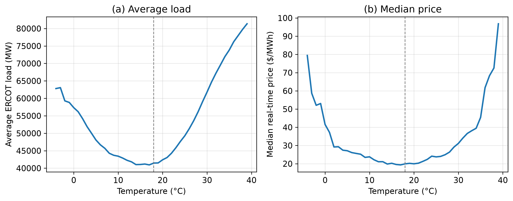
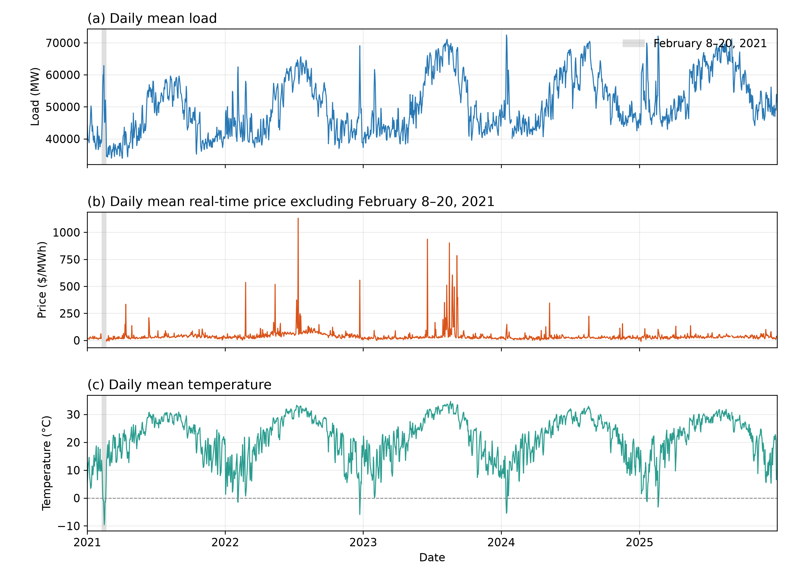

# **Weather, Electricity Demand, and Real-Time Prices in ERCOT**

Kyungsu Noh

MA Student in Economics, The University of Texas at Austin

### 1. Introduction

Understanding how weather relates to electricity demand and wholesale prices is important for supply planning and price risk management in Texas. This study examines these relationships in the Electric Reliability Council of Texas (ERCOT) market during 2021–2025, using separate load and real-time price regressions with weather controls and time fixed effects.

The results show that load is more sensitive to heat than to cold, while prices are strongly associated with both. The estimated association between cold weather and prices weakens substantially when the February 2021 winter storm period is excluded. The findings inform discussions of supply planning, price risk management, and the potential value of battery storage.

### 2. Background and Literature Review

ERCOT operates a wholesale electricity market covering most of Texas. Its scarcity-pricing mechanisms can raise real-time electricity prices when operating reserves are low (ERCOT, 2025).

Shaffer et al. (2022) studied approximately 20 years of hourly data across ERCOT’s eight weather zones and found increasing demand sensitivity to cold temperatures. Their use of hourly data and time fixed effects informs this study, which examines both system-wide load and real-time prices over 2021–2025.

The joint report by the Federal Energy Regulatory Commission, the North American Electric Reliability Corporation, and Regional Entities (2021) documented widespread generation failures during Winter Storm Uri and recommended stronger winter preparation and coordination between natural gas and electricity systems. Its February 8–20 event window guides this study’s storm-exclusion robustness check.

The U.S. Energy Information Administration (2025) reports that half of ERCOT’s battery capacity at the end of 2024 was primarily used for price arbitrage, providing context for this study’s discussion of storage and hourly price differences.

### 3. Theoretical Framework

Hot and cold weather can increase electricity demand for cooling and electric heating. Demand may therefore be higher at both high and low temperatures than under mild conditions. In addition, the responses to heat and cold may differ because cooling and heating systems use different technologies and energy sources. This motivates using separate cooling degree-hour (CDD) and heating degree-hour (HDD) variables.

Electricity prices reflect both demand and supply. Higher demand may raise prices when additional supply is limited, while weather can also affect wind and solar generation and the availability of other generators. We estimate separate regressions to examine how load and prices are associated with weather. These regressions do not establish that higher demand causes higher prices or determine how much of the weather-related price change comes from demand versus supply.

### 4. Data and Methodology

**Data.** We use hourly data from January 1, 2021 to December 31, 2025 (43,824 hours). Electricity demand is ERCOT system-wide hourly load (MW). Prices are ERCOT Hub Average real-time settlement point prices ($/MWh), calculated as the simple average of the North, South, Houston, and West hub prices. We aggregate the 15-minute prices to hourly values by averaging the four intervals within each hour.

Hourly temperature (°C), relative humidity (%), and wind speed (m/s) data come from airport observations provided by the National Oceanic and Atmospheric Administration’s National Centers for Environmental Information (NOAA NCEI). We use four major Texas locations: Dallas–Fort Worth, Houston, San Antonio, and Austin. We construct population-weighted weather indices using average metropolitan populations over 2021–2025 (U.S. Census Bureau, via Federal Reserve Economic Data [FRED]). We match weather observations to ERCOT hours using UTC timestamps to avoid ambiguity during daylight saving time transitions.

We exclude 395 hours (0.9%) with missing weather data at any of the four airports, which we do not impute, and three hours with physically impossible relative humidity values (outside 0–100%). The load regression therefore uses 43,426 hourly observations. Because the logarithm is undefined for non-positive values, the price regression additionally excludes 920 hours (2.1%) with zero or negative prices, leaving 42,506 observations; its estimates therefore describe hours with positive prices. Table 1 reports summary statistics for these samples.

**Table 1. Summary statistics, hourly observations, 2021–2025**

| Variable              | Mean   | Median | Std    | Min    | Max     | N      |
| --------------------- | ------ | ------ | ------ | ------ | ------- | ------ |
| Load (MW)             | 50,563 | 48,076 | 11,120 | 27,800 | 85,464  | 43,426 |
| Price, all ($/MWh)    | 63.9   | 24.8   | 451.2  | -34.8  | 9,024.1 | 43,426 |
| Price > 0 ($/MWh)    | 65.4   | 25.1   | 456.0  | 0.0025 | 9,024.1 | 42,506 |
| Temperature (°C)     | 21.16  | 22.51  | 8.78   | -13.78 | 41.46   | 43,426 |
| CDD (degree-hours)    | 5.51   | 4.51   | 5.50   | 0.00   | 23.46   | 43,426 |
| HDD (degree-hours)    | 2.35   | 0.00   | 4.57   | 0.00   | 31.78   | 43,426 |
| Relative humidity (%) | 65.74  | 68.03  | 18.24  | 9.85   | 100.00  | 43,426 |
| Wind speed (m/s)      | 3.96   | 3.74   | 1.90   | 0.00   | 13.11   | 43,426 |

*Notes:* Statistics use the load regression sample (N = 43,426 hourly observations) unless otherwise indicated. The positive-price row uses the price regression sample. Weather variables are population-weighted averages of four airport stations. CDD and HDD use an 18°C base; their statistics include zero-value hours. Sources: ERCOT, NOAA, U.S. Census Bureau via FRED.

**Empirical strategy.** We define cooling and heating degree-hours relative to 18°C, approximately 65°F, a common base temperature in NOAA’s degree-day products (NOAA NCEI, LCDv2 documentation):

```math
\text{CDD}_t = \max{(T_t-18, 0)}, \text{HDD}_t = \max{(18-T_t, 0)}
```

where T_t is the population-weighted hourly temperature in °C. Because observations are hourly, these measures are degree-hours rather than degree-days. We estimate separate regressions for electricity load and real-time prices:

```math
\ln(\text{Y}_t) = \beta_0 + \beta_1 \text{CDD}_t + \beta_2 \text{HDD}_t + \beta_3 \text{Humidity}_t + \beta_4 \text{Wind speed}_t + \text{Hour/Month/Year FE} + \varepsilon_t
```

Here, t indexes hours and Y_t is either ERCOT load or the real-time price. Hour, month, and year fixed effects control for recurring intraday and seasonal patterns and annual differences in demand and market conditions. Hour indicators use hour-ending labels; month and year are based on the start of each hour.

We use heteroskedasticity- and autocorrelation-consistent (HAC) standard errors with a maximum lag of 24 observations. The CDD and HDD coefficients, multiplied by 100, approximate the percentage change in Y_t associated with one additional degree-hour, holding the other included variables fixed. We test whether β₁ = β₂ to compare sensitivity to heat and cold.

### 5. Results and Analysis

Figure 1 shows that load and prices are lowest at mild temperatures (about 14–19°C) and rise at hotter and colder temperatures. Load is higher at the hot extreme than at the cold extreme, although these extreme bins contain relatively few observations and should be interpreted cautiously. Figures 1 and 2 report median prices to reduce the influence of occasional price spikes.



**Figure 1.** Average ERCOT load (a) and median real-time price (b) by hourly temperature, 2021–2025. Temperatures are rounded to the nearest °C. Bins with fewer than 50 observations (below −4°C or above 39°C, 202 observations in total) are not shown. The dashed line marks 18°C. Prices are hourly HB_HUBAVG averages. Sources: ERCOT, NOAA; authors’ calculations.

Figure 2 compares hot and cold weather at equal distances from 18°C. At 15 degree-hours, average load is about 69,500 MW for CDD versus 51,900 MW for HDD, while median prices are approximately $38 versus $29/MWh. These descriptive comparisons do not control for other weather variables or time patterns.


**Figure 2.** Average ERCOT load (a) and median real-time price (b) by CDD and HDD relative to 18°C. Degree-hours are rounded to integers. Hours with fewer than 0.5 degree-hours and bins with fewer than 50 observations are omitted. Sources: ERCOT, NOAA; authors’ calculations.

Table 2 shows that, holding other included variables fixed, one additional cooling degree-hour is associated with about 2.8% higher load, compared with 1.9% for heating. The difference is statistically significant (p < 0.001). The year coefficients imply approximately 23% higher load in 2025 than in 2021, conditional on the included controls (Appendix Table A1). Table 3 illustrates the implied load differences at selected temperatures.

**Table 2. Weather and ERCOT load and prices**

| Dependent variable | CDD       | HDD       | Humidity  | Wind speed  | CDD − HDD | N      | R²   |
| ------------------ | --------- | --------- | --------- | ----------- | ---------- | ------ | ----- |
| ln(Load)           | 0.0281*** | 0.0188*** | 0.0008*** | 0.0059***   | 0.0093***  | 43,426 | 0.922 |
|                    | (0.0003)  | (0.0005)  | (0.0001)  | (0.0005)    | (0.0006)   |        |       |
| ln(Price)          | 0.0771*** | 0.0809*** | 0.0080*** | −0.0633*** | −0.0038   | 42,506 | 0.341 |
|                    | (0.0038)  | (0.0089)  | (0.0009)  | (0.0066)    | (0.0088)   |        |       |

*Notes:* HAC standard errors, calculated using actual UTC time intervals with a maximum lag of 24 hours, are shown in parentheses. *** p < 0.001. All regressions include hour, month, and year fixed effects. The price regression excludes 920 hours (2.1%) with non-positive prices. CDD and HDD are degree-hours relative to 18°C.

**Table 3. Implied Change in ERCOT Load Relative to an 18°C Hour**

| Scenario                 | Calculation                 | Model-implied load increase |
| ------------------------ | --------------------------- | --------------------------- |
| 8°C (10°C below base)  | 100[exp(10 × 0.0188) − 1] | ≈ 21%                      |
| 28°C (10°C above base) | 100[exp(10 × 0.0281) − 1] | ≈ 32%                      |
| 33°C (15°C above base) | 100[exp(15 × 0.0281) − 1] | ≈ 52%                      |

Note: Calculated as 100[exp(β × degree-hours) − 1] using Table 2 coefficients, holding other included variables fixed. The model assumes constant percentage responses to cooling and heating degree-hours.

Prices respond more strongly to weather than load does: one additional degree-hour of either cooling or heating is associated with about 8% higher prices in the full positive-price sample (Table 2). We find no statistically significant difference between the CDD and HDD coefficients (p = 0.67; Appendix Table A4). Holding other included variables fixed, the model implies that prices in the 7–8 pm hour are approximately 2.6 times those in the 3–4 am hour (exp[0.6932 − (−0.2533)] ≈ 2.58; Appendix Table A3).

This heat-cold price comparison is sensitive to Winter Storm Uri. Excluding February 8–20, 2021 (301 hours, 0.7% of the price sample) lowers the HDD coefficient from 0.0809 to 0.0543. Cooling degree-hours are then more strongly associated with prices than heating degree-hours, with a statistically significant coefficient difference (p < 0.001). The load results barely change (Appendix Table A5).

### 6. Policy, Technical Implications and Discussion

First, load rises more with heat than with cold (about 2.8% versus 1.9% per degree-hour), and the estimated 2025 load is about 23% above 2021 after controlling for weather and other included factors. These findings suggest that supply planning should account for higher demand during hot weather as well as growth in overall demand.

Second, prices are more sensitive to temperature than load, and median prices at the temperature extremes are four to five times their minimum (Figure 1). Sudden price spikes can greatly increase costs for electricity retailers and large consumers that pay real-time prices. These businesses may reduce their exposure by locking in prices in advance or reducing electricity use during high-price hours.

Third, after controlling for weather and other included factors, prices in the 7–8 pm hour are approximately 2.6 times those in the 3–4 am hour. This pattern suggests a potential role for battery energy storage systems (BESS), which charge during lower-price hours and discharge during higher-price hours. This strategy is already used in ERCOT: at the end of 2024, half of its 8.1 GW of battery capacity was primarily used for price arbitrage (EIA, 2025). Thus, these price differences could encourage greater use of BESS if revenues are sufficient to cover charging and equipment costs.

Finally, winter planning should consider rare but severe storms. Excluding the February 2021 storm window (0.7% of the price sample) lowers the HDD coefficient by about one-third. Although this analysis does not identify the causes of the storm-related price increases, the result suggests that typical winter conditions alone provide an incomplete basis for assessing winter market risk. Preparing generation facilities and fuel supplies for severe cold may help address this risk.

### 7. Conclusion

Using hourly ERCOT data from 2021–2025, this study finds that load is more sensitive to heat than to cold, while prices are strongly associated with both. The cold-weather price estimate falls substantially when the February 2021 storm period is excluded. Together with the highly skewed price distribution, this result highlights the importance of extreme events when assessing electricity price risk. These findings suggest a role for adequate reserves, demand response, and grid resilience in managing weather-related market stress.

Several limitations remain. The linear CDD/HDD specification does not capture whether temperature effects accelerate at more extreme temperatures. Although HAC standard errors account for serial correlation, the model does not explicitly capture demand and price dynamics over time. There is also a geographic mismatch: prices reflect a four-hub average that includes West Texas, whereas the weather index covers four major metropolitan areas and excludes that region. Finally, taking logarithms excludes zero and negative prices, potentially creating sample selection concerns and limiting the price results to positive-price hours.

Future research could include weather data from more parts of Texas and data on electricity generation, and use methods that allow for zero and negative prices. Comparing ERCOT with electricity markets in other U.S. states or other countries could clarify how market rules, energy sources, and weather conditions shape these relationships.

### 8. References

Electric Reliability Council of Texas. (2025, October).  *ERCOT energy-only wholesale market*. [https://www.ercot.com/files/docs/2025/10/16/ERCOT-Grid-Insights-Energy-Only-Wholesale-Market.pdf](https://www.ercot.com/files/docs/2025/10/16/ERCOT-Grid-Insights-Energy-Only-Wholesale-Market.pdf)

Federal Energy Regulatory Commission, North American Electric Reliability Corporation, & Regional Entities. (2021, November). *The February 2021 cold weather outages in Texas and the South Central United States*. [https://www.ferc.gov/media/february-2021-cold-weather-outages-texas-and-south-central-united-states-ferc-nerc-and](https://www.ferc.gov/media/february-2021-cold-weather-outages-texas-and-south-central-united-states-ferc-nerc-and)

Kantor, D., Casey, N. W., Menne, M. J., & Buddenberg, A. (2023). *Local climatological data (LCD), version 2* [Data set; hourly observations for AUS, DFW, IAH, and SAT, 2021–2025]. NOAA National Centers for Environmental Information. [https://www.ncei.noaa.gov/products/land-based-station/local-climatological-data](https://www.ncei.noaa.gov/products/land-based-station/local-climatological-data). Accessed October 2026.

Shaffer, B., Quintero, D., & Rhodes, J. (2022). Changing sensitivity to cold weather in Texas power demand.  *iScience, 25*(4), 104173. [https://doi.org/10.1016/j.isci.2022.104173](https://doi.org/10.1016/j.isci.2022.104173)

U.S. Energy Information Administration. (2025, September 22).  *Utility-scale batteries are more commonly used for price arbitrage*. [https://www.eia.gov/todayinenergy/detail.php?id=66164](https://www.eia.gov/todayinenergy/detail.php?id=66164)

##### **Data sources**

| Resource                                              | Source                                                                                                       | Dataset or identifier                                                                                                                                                                                                                 |
| ----------------------------------------------------- | ------------------------------------------------------------------------------------------------------------ | ------------------------------------------------------------------------------------------------------------------------------------------------------------------------------------------------------------------------------------- |
| Hourly electricity load                               | Electric Reliability Council of Texas (ERCOT)                                                                | [Hourly Load Data Archives](https://www.ercot.com/gridinfo/load/load_hist), 2021–2025                                                                                                                                                 |
| Real-time electricity prices                          | ERCOT                                                                                                        | [Historical RTM Load Zone and Hub Prices](https://www.ercot.com/mp/data-products/data-product-details?id=NP6-785-ER); RTMLZHBSPP_2021–2025, HB_HUBAVG                                                                                 |
| Hourly temperature, relative humidity, and wind speed | National Oceanic and Atmospheric Administration (NOAA) National Centers for Environmental Information (NCEI) | [Local Climatological Data, Version 2](https://www.ncei.noaa.gov/products/land-based-station/local-climatological-data), 2021-2025. Airport codes: AUS, DFW, IAH, SAT.                                                               |
| Annual metropolitan population                        | U.S. Census Bureau, via Federal Reserve Economic Data (FRED)                                                | [DFWPOP](https://fred.stlouisfed.org/series/DFWPOP), [HTNPOP](https://fred.stlouisfed.org/series/HTNPOP), [SATPOP](https://fred.stlouisfed.org/series/SATPOP), [AUSPOP](https://fred.stlouisfed.org/series/AUSPOP), 2021-2025 (annual) |
| Software                                              | Python Software Foundation                                                                                   | [Python 3.12.3](https://www.python.org/downloads/); pandas, NumPy, openpyxl, Matplotlib, and statsmodels                                                                                                                               |

*Note:* Weather station identifiers are AUS: USW00013904; DFW: USW00003927; IAH: USW00012960; and SAT: USW00012921. Weather observations are weighted using average metropolitan population shares over 2021–2025: Dallas–Fort Worth (0.3891), Houston (0.3621), San Antonio (0.1296), and Austin (0.1192). The same weights are applied to temperature, relative humidity, and wind speed.

##### **Data and code availability**

All data used in the analysis (electricity load, electricity prices, weather, and population) and all original analysis code have been deposited in the GitHub repository at [http://github.com/nks1216/energy/](http://github.com/nks1216/energy/).
The repository will be publicly available on November 22, 2026.

### 9. Appendix

**Figure A1.** Daily mean load, price, temperature


Daily mean ERCOT load (a), real-time hub-average price (b), and population-weighted temperature (c), 2021–2025. Daily means use available hourly observations after excluding missing regression variables and relative humidity values outside 0–100%. Zero and negative prices are included, and no temperature bins are excluded. Shading marks February 8–20, 2021. Sources: ERCOT, NOAA NCEI; authors’ calculations.

**Figure A2.** Daily series with storm-period prices excluded



Daily series from Figure A1 with February 8–20, 2021 excluded from the price panel only. The excluded prices are shown as a gap, and the price axis is rescaled to show variation outside this period. Load and temperature are unchanged. Sources: ERCOT, NOAA NCEI; authors’ calculations.

**Table A1:** Full regression results for log electricity load

```text
                            OLS Regression Results            
==============================================================================
Dep. Variable:               log_load   R-squared:                       0.922
Model:                            OLS   Adj. R-squared:                  0.922
Method:                 Least Squares   F-statistic:                     2865.
Date:                Thu, 12 Nov 2026   Prob (F-statistic):               0.00
Time:                        14:15:37   Log-Likelihood:                 61288.
No. Observations:               43426   AIC:                        -1.225e+05
Df Residuals:                   43383   BIC:                        -1.221e+05
Df Model:                          42                         
Covariance Type:                  HAC                         
==========================================================================================
                             coef    std err          z      P>|z|      [0.025      0.975]
------------------------------------------------------------------------------------------
Intercept                 10.3840      0.009   1198.303      0.000      10.367      10.401
C(hour)[T.1]              -0.0451      0.001    -75.726      0.000      -0.046      -0.044
C(hour)[T.2]              -0.0779      0.001    -94.519      0.000      -0.080      -0.076
C(hour)[T.3]              -0.1001      0.001    -96.422      0.000      -0.102      -0.098
C(hour)[T.4]              -0.1109      0.001    -89.898      0.000      -0.113      -0.108
C(hour)[T.5]              -0.1060      0.001    -75.162      0.000      -0.109      -0.103
C(hour)[T.6]              -0.0788      0.002    -48.250      0.000      -0.082      -0.076
C(hour)[T.7]              -0.0374      0.002    -18.541      0.000      -0.041      -0.033
C(hour)[T.8]              -0.0204      0.002     -8.849      0.000      -0.025      -0.016
C(hour)[T.9]              -0.0019      0.002     -0.794      0.427      -0.007       0.003
C(hour)[T.10]              0.0174      0.002      6.970      0.000       0.013       0.022
C(hour)[T.11]              0.0317      0.003     12.534      0.000       0.027       0.037
C(hour)[T.12]              0.0417      0.003     16.643      0.000       0.037       0.047
C(hour)[T.13]              0.0489      0.002     19.555      0.000       0.044       0.054
C(hour)[T.14]              0.0570      0.003     22.560      0.000       0.052       0.062
C(hour)[T.15]              0.0628      0.003     24.616      0.000       0.058       0.068
C(hour)[T.16]              0.0706      0.003     27.884      0.000       0.066       0.076
C(hour)[T.17]              0.0827      0.002     33.892      0.000       0.078       0.088
C(hour)[T.18]              0.0974      0.002     43.228      0.000       0.093       0.102
C(hour)[T.19]              0.1102      0.002     53.909      0.000       0.106       0.114
C(hour)[T.20]              0.1138      0.002     67.599      0.000       0.111       0.117
C(hour)[T.21]              0.1100      0.001     84.087      0.000       0.107       0.113
C(hour)[T.22]              0.0908      0.001     95.297      0.000       0.089       0.093
C(hour)[T.23]              0.0496      0.001     80.990      0.000       0.048       0.051
C(month)[T.2]             -0.0176      0.007     -2.581      0.010      -0.031      -0.004
C(month)[T.3]             -0.0454      0.006     -8.015      0.000      -0.056      -0.034
C(month)[T.4]             -0.0240      0.006     -3.777      0.000      -0.036      -0.012
C(month)[T.5]              0.0320      0.007      4.861      0.000       0.019       0.045
C(month)[T.6]              0.0835      0.007     11.816      0.000       0.070       0.097
C(month)[T.7]              0.0883      0.008     11.589      0.000       0.073       0.103
C(month)[T.8]              0.1118      0.007     15.206      0.000       0.097       0.126
C(month)[T.9]              0.0846      0.007     12.109      0.000       0.071       0.098
C(month)[T.10]             0.0356      0.007      4.909      0.000       0.021       0.050
C(month)[T.11]            -0.0018      0.006     -0.326      0.744      -0.013       0.009
C(month)[T.12]             0.0192      0.005      3.819      0.000       0.009       0.029
C(year)[T.2022]            0.0607      0.003     18.645      0.000       0.054       0.067
C(year)[T.2023]            0.1014      0.003     32.427      0.000       0.095       0.108
C(year)[T.2024]            0.1452      0.003     47.263      0.000       0.139       0.151
C(year)[T.2025]            0.2043      0.003     66.257      0.000       0.198       0.210
CDD                        0.0281      0.000     91.516      0.000       0.028       0.029
HDD                        0.0188      0.001     35.346      0.000       0.018       0.020
HourlyRelativeHumidity     0.0008    6.9e-05     11.510      0.000       0.001       0.001
HourlyWindSpeed            0.0059      0.001     11.102      0.000       0.005       0.007
==============================================================================

Notes: HAC standard errors using actual UTC hourly intervals, with a maximum lag of 24 hours.
```

The dependent variable is log electricity load. Reference categories are hour 0 (23:00–24:00), January, and 2021. Hour indicators use hour-ending labels: hour 1 represents 00:00–01:00, and hour 20 represents 19:00–20:00. Month and year are determined by the start of each hour. For example, the hour ending at 00:00 on January 1, 2022 covers 23:00–24:00 on December 31, 2021 and is assigned to December 2021.

**Table A2.** Test of equal cooling and heating coefficients for log electricity load

```
                             Test for Constraints             
==============================================================================
                 coef    std err          z      P>|z|     [0.025     0.975]
------------------------------------------------------------------------------
c0             0.0093     0.0006     15.110      0.000     0.0081     0.0105
==============================================================================
```

The null hypothesis is $H_0: \beta_{\mathrm{CDD}} - \beta_{\mathrm{HDD}} = 0$.

**Table A3.** Full regression results for log electricity price

```
                            OLS Regression Results            
==============================================================================
Dep. Variable:              log_price   R-squared:                       0.341
Model:                            OLS   Adj. R-squared:                  0.341
Method:                 Least Squares   F-statistic:                     99.43
Date:                Thu, 12 Nov 2026   Prob (F-statistic):               0.00
Time:                        14:22:30   Log-Likelihood:                -47598.
No. Observations:               42506   AIC:                         9.528e+04
Df Residuals:                   42463   BIC:                         9.565e+04
Df Model:                          42                         
Covariance Type:                  HAC                         
==========================================================================================
                             coef    std err          z      P>|z|      [0.025      0.975]
------------------------------------------------------------------------------------------
Intercept                  2.0977      0.122     17.256      0.000       1.859       2.336
C(hour)[T.1]              -0.0753      0.011     -6.565      0.000      -0.098      -0.053
C(hour)[T.2]              -0.1701      0.014    -12.454      0.000      -0.197      -0.143
C(hour)[T.3]              -0.2527      0.017    -15.264      0.000      -0.285      -0.220
C(hour)[T.4]              -0.2533      0.018    -14.372      0.000      -0.288      -0.219
C(hour)[T.5]              -0.2238      0.019    -11.913      0.000      -0.261      -0.187
C(hour)[T.6]              -0.1030      0.019     -5.373      0.000      -0.141      -0.065
C(hour)[T.7]               0.0714      0.021      3.384      0.001       0.030       0.113
C(hour)[T.8]               0.0638      0.019      3.273      0.001       0.026       0.102
C(hour)[T.9]              -0.0892      0.018     -4.868      0.000      -0.125      -0.053
C(hour)[T.10]             -0.1457      0.022     -6.632      0.000      -0.189      -0.103
C(hour)[T.11]             -0.1058      0.024     -4.326      0.000      -0.154      -0.058
C(hour)[T.12]             -0.0598      0.028     -2.157      0.031      -0.114      -0.005
C(hour)[T.13]              0.0010      0.031      0.032      0.974      -0.061       0.063
C(hour)[T.14]              0.0584      0.033      1.762      0.078      -0.007       0.123
C(hour)[T.15]              0.0931      0.034      2.728      0.006       0.026       0.160
C(hour)[T.16]              0.1589      0.033      4.802      0.000       0.094       0.224
C(hour)[T.17]              0.2902      0.033      8.745      0.000       0.225       0.355
C(hour)[T.18]              0.4750      0.030     16.033      0.000       0.417       0.533
C(hour)[T.19]              0.5922      0.025     23.604      0.000       0.543       0.641
C(hour)[T.20]              0.6932      0.022     31.229      0.000       0.650       0.737
C(hour)[T.21]              0.5848      0.018     32.042      0.000       0.549       0.621
C(hour)[T.22]              0.3266      0.013     25.407      0.000       0.301       0.352
C(hour)[T.23]              0.1577      0.010     15.027      0.000       0.137       0.178
C(month)[T.2]              0.1310      0.105      1.246      0.213      -0.075       0.337
C(month)[T.3]              0.2228      0.072      3.091      0.002       0.082       0.364
C(month)[T.4]              0.3278      0.078      4.199      0.000       0.175       0.481
C(month)[T.5]              0.3665      0.083      4.402      0.000       0.203       0.530
C(month)[T.6]              0.1896      0.086      2.210      0.027       0.021       0.358
C(month)[T.7]              0.1917      0.087      2.198      0.028       0.021       0.363
C(month)[T.8]              0.3680      0.090      4.098      0.000       0.192       0.544
C(month)[T.9]              0.3887      0.088      4.427      0.000       0.217       0.561
C(month)[T.10]             0.5141      0.083      6.212      0.000       0.352       0.676
C(month)[T.11]             0.4379      0.065      6.713      0.000       0.310       0.566
C(month)[T.12]             0.2499      0.058      4.279      0.000       0.135       0.364
C(year)[T.2022]            0.3594      0.045      8.026      0.000       0.272       0.447
C(year)[T.2023]           -0.2406      0.039     -6.120      0.000      -0.318      -0.164
C(year)[T.2024]           -0.4579      0.041    -11.039      0.000      -0.539      -0.377
C(year)[T.2025]           -0.0978      0.040     -2.468      0.014      -0.176      -0.020
CDD                        0.0771      0.004     20.560      0.000       0.070       0.084
HDD                        0.0809      0.009      9.092      0.000       0.063       0.098
HourlyRelativeHumidity     0.0080      0.001      8.866      0.000       0.006       0.010
HourlyWindSpeed           -0.0633      0.007     -9.648      0.000      -0.076      -0.050
==============================================================================

Notes: HAC standard errors using actual UTC hourly intervals, with a maximum lag of 24 hours.
```

The dependent variable is log electricity price. Only positive-price hours are included. Reference categories are hour 0 (23:00–24:00), January, and 2021. Hour indicators use hour-ending labels: hour 1 represents 00:00–01:00, and hour 20 represents 19:00–20:00. Month and year are determined by the start of each hour. For example, the hour ending at 00:00 on January 1, 2022 covers 23:00–24:00 on December 31, 2021 and is assigned to December 2021.

**Table A4.** Test of equal cooling and heating coefficients for log electricity price

```
                             Test for Constraints             
==============================================================================
                 coef    std err          z      P>|z|     [0.025     0.975]
------------------------------------------------------------------------------
c0            -0.0038     0.0088     -0.432      0.666    -0.0209     0.0134
==============================================================================
```

The null hypothesis is $H_0: \beta_{\mathrm{CDD}} - \beta_{\mathrm{HDD}} = 0$.

**Table A5.** Sensitivity to Winter Storm Uri (February 8–20, 2021)

|            | Load, full | Load, excl. Uri | Price, full | Price, excl. Uri |
| ---------- | ---------- | --------------- | ----------- | ---------------- |
| CDD        | 0.0281***  | 0.0281***       | 0.0771***   | 0.0742***        |
|            | (0.0003)   | (0.0003)        | (0.0038)    | (0.0035)         |
| HDD        | 0.0188***  | 0.0189***       | 0.0809***   | 0.0543***        |
|            | (0.0005)   | (0.0005)        | (0.0089)    | (0.0036)         |
| CDD − HDD | 0.0093***  | 0.0092***       | −0.0038    | 0.0199***        |
|            | (0.0006)   | (0.0006)        | (0.0088)    | (0.0048)         |
| N          | 43,426     | 43,114          | 42,506      | 42,205           |
| R²        | 0.922      | 0.925           | 0.341       | 0.356            |

HAC standard errors accounting for actual time gaps, with a maximum lag of 24 hours, are shown in parentheses. *** p < 0.001. All regressions include humidity, wind speed, and hour, month, and year fixed effects. “Excl. Uri” excludes February 8–20, 2021. Load and price are in logarithms; price regressions include only positive-price hours.

As a robustness check, we re-estimate the regressions after excluding February 8–20, 2021. The load coefficients remain nearly unchanged. However, the price coefficient on HDD falls from 0.0809 to 0.0543, while the CDD coefficient decreases only slightly. The difference between the CDD and HDD price coefficients becomes statistically significant (p < 0.001). Thus, the load findings are stable, but the comparison of hot- and cold-weather price sensitivity depends on whether the storm period is included.

### 10. AI Disclosure

The following generative AI tools were used in the preparation of this paper:

**ChatGPT:** Assistance with Python code development for merging annual raw datasets and conducting robustness checks. ChatGPT was also used to identify relevant background materials, including policy documents, technical reports, and academic literature.

**Claude:** Assistance with Python code development for data preprocessing and integration of datasets from multiple sources into a unified dataset, including the creation of CDD and HDD variables, the conversion of timestamps to UTC, resolving daylight saving time (DST) issues, and identifying data anomalies and potential errors. Claude was also used to assist with Python code development for regression analysis and data visualization.

**Copilot:** Translation, language editing, proofreading, and improving the clarity and readability of the manuscript.

All final analyses, interpretations, and conclusions are the author's own. AI tools were used solely for coding assistance, literature search support, translation, proofreading, and language improvement. The research design, model specification, and interpretation of results were completed by the author.

### 11. Reproducibility

The scripts should be executed in the order shown below.

(1) Clone the repository

```
git clone https://github.com/nks1216/energy.git
cd energy
```

(2) Set up the virtual environment

```
python3 -m venv venv			 # Create a virtual environment
source venv/bin/activate		 # Activate the virtual environment
pip install -r requirements.txt  		# Install all required packages
```

(3) Download the data

Place the downloaded files in:

```
data/raw/ercot
data/raw/noaa
data/raw/population 
data/raw/price
```

(4) Run the scripts

```
# Merge each annual data 
python3 src/data/merge_ercot.py
python3 src/data/merge_noaa_city.py
python3 src/data/merge_noaa_texas.py		# Optional (not required for final results)
python3 src/data/merge_pop.py
python3 src/data/merge_price.py

# Merge data from different sources
python3 src/clean/utc_noaa.py
python3 src/clean/merge_ercot_price.py
python3 src/clean/merge_all.py

# Create CDD and HDD variables
python3 src/clean/create_cdd_hdd.py		# Create data/final/final_data_cdd_hdd.csv

# Make table and graphs
python3 src/analysis/summary_stats.py		# Table 1
python3 src/analysis/temp_load_price.py		# Figure 1
python3 src/analysis/cdd_hdd_load_price.py	# Figure 2
python3 src/analysis/daily_overview.py		# Figure A1, A2

# Make regression
python3 src/reg/reg_load_log.py			# Table A1, A2
python3 src/reg/reg_price_droplog.py		# Table A3, A4
python3 src/reg/se_reg.py				

# Robustness check
python3 src/robust/reg_uri_check.py		# Table A5
```
