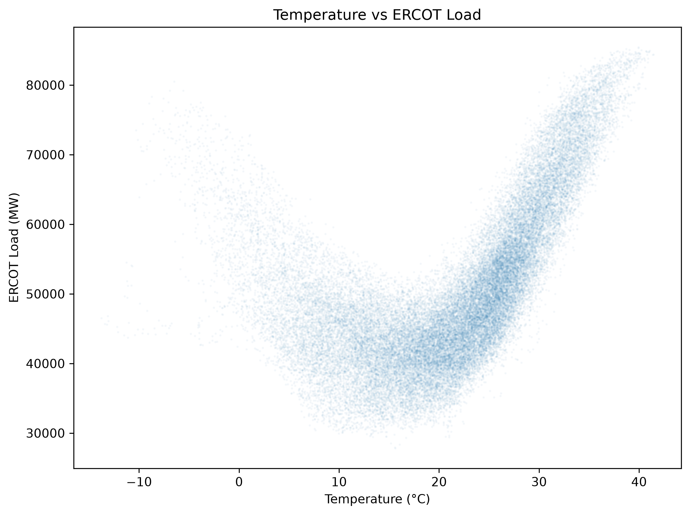
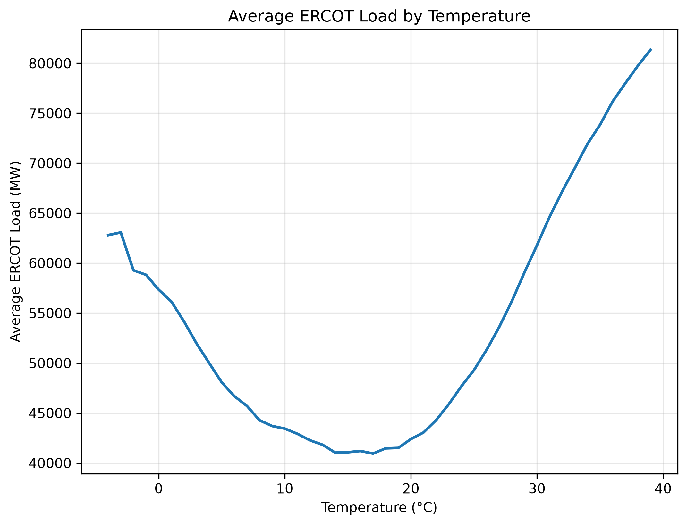
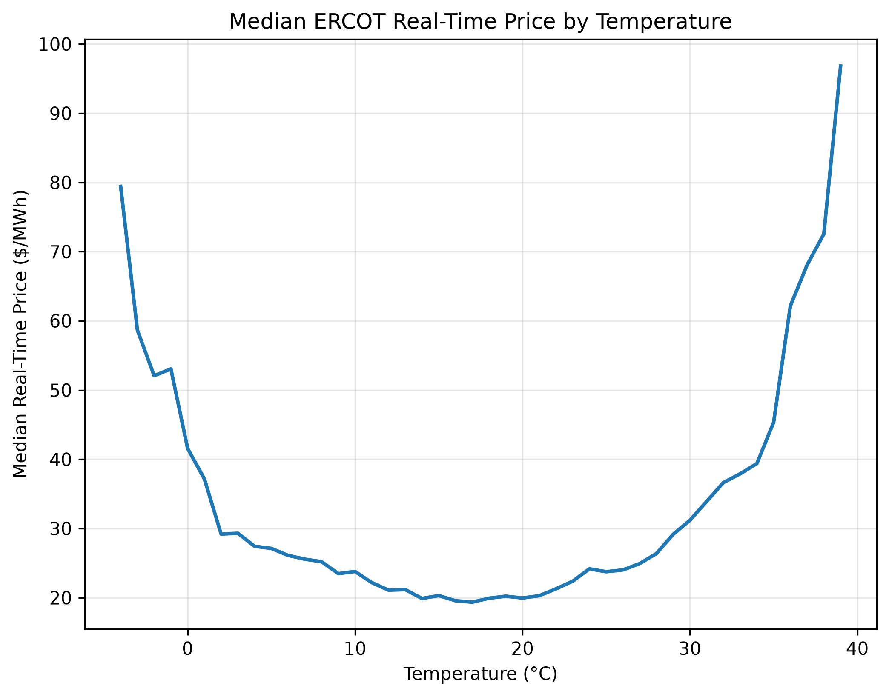
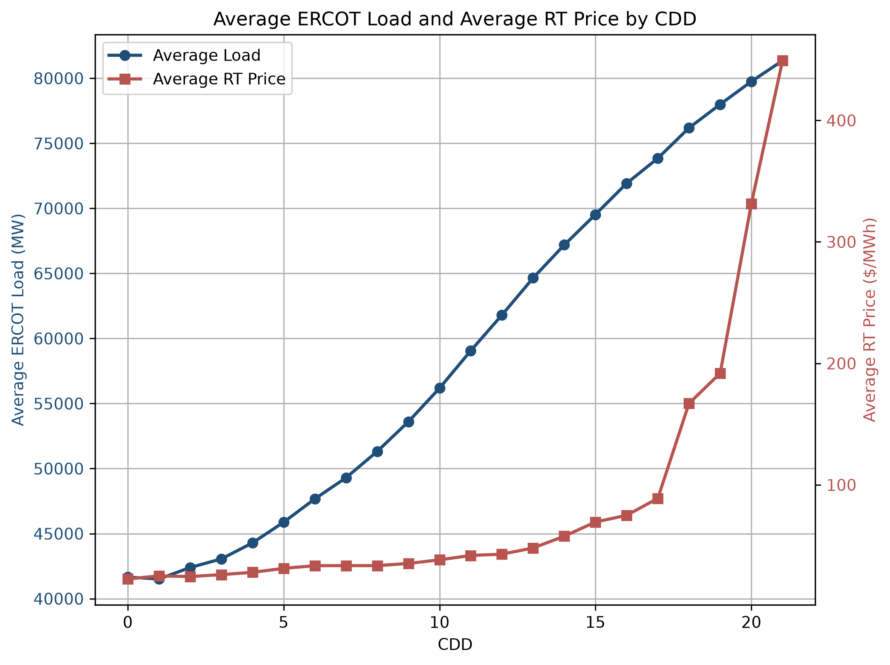

**How does weather affect ERCOT electricity demand and wholesale electricity prices?**

Introduction (3/4)

Background and Literature Review (3/4)

Theoretical Framework (1/2)

Data and Methodology (3/4)

Results and Analysis (1 1/4)

| Variable         | Mean     | Std      | Min      | Max      | N     |
| ---------------- | -------- | -------- | -------- | -------- | ----- |
| ERCOT Load (MW)  | 50585.51 | 11118.26 | 27800.15 | 85464.12 | 43824 |
| RT Price ($/MWh) | 63.61    | 449.19   | -34.83   | 9024.06  | 43824 |
| Temperature (C)  | 21.16    | 8.78     | -13.78   | 41.46    | 43495 |
| Humidity (%)     | 65.73    | 18.26    | 9.85     | 150.24   | 43493 |
| Wind Speed       | 3.96     | 1.9      | 0.0      | 13.11    | 43443 |



Figure 1 shows the relationship between temperature and ERCOT electricity demand. Electricity demand is lowest at approximately 15-18°C and increases as temperatures become either colder or hotter. This creates a clear U-shaped relationship between temperature and electricity demand.



Figure 2 confirms the U-shaped relationship observed in Figure 1. Average electricity demand is lowest around 15-17°C and rises as temperatures move away from this range. The increase in demand is larger during very hot weather than during very cold weather, suggesting that air-conditioning demand plays an important role in ERCOT electricity consumption.



Figure 3. Median ERCOT real-time electricity price by temperature. Temperature bins with fewer than 50 observations were excluded. Prices are based on ERCOT RTMLZHBSPP settlement point prices for 2021-2025

Heating and cooling degree variables are constructed using a base temperature of 18°C.

* CDD = Cooling Degree Days
* HDD = Heating Degree Days


Bins with fewer than 50 observations were excluded, and only observations with positive Heating Degree Days (HDD > 0) were retained. Since HDD values were rounded to the nearest integer for plotting, the HDD = 0 bin corresponds to observations with small positive HDD values rather than observations with zero heating demand.

Average ERCOT load increases monotonically with both cooling and heating degree days. However, the relationship is considerably steeper for CDD than for HDD, suggesting that electricity demand in Texas is more sensitive to cooling needs than to heating needs. The pattern is consistent with the state's heavy reliance on air conditioning during hot weather.




ERCOT Load and Electricity Prices by Cooling Degree Days (CDD)

Bins with fewer than 50 observations were excluded. CDD values were rounded to the nearest integer for visualization, and only observations with positive CDD values were retained.

Average ERCOT load increases steadily with CDD, indicating higher electricity demand during hotter weather. Both average and median real-time (RT) prices also increase with CDD. However, average RT prices rise much more sharply than median RT prices at high CDD levels, suggesting that extreme heat is associated with occasional scarcity-pricing events and price spikes in the ERCOT market.


Policy Implications or Discussion (1/2)

Conclusion (1/3)

References (Seperate)

**더운 날의 전력수요와 도매가격: ERCOT의 2021–2025년 자료 분석

질문								사용할 자료

더운 날에는 전기를 얼마나 더 쓰는가? / 일평균 기온 + 일평균 전력수요

더운 날에는 전력가격이 얼마나 더 높은가? / 일평균 기온 + 일평균 도매가격

**여름철 자료만 사용해서** , 비교적 덜 더운 날과 매우 더운 날을 비교

기온 구간은 자료 분포를 확인한 뒤 정하고, 이후 간단한 회귀분석으로 연도·월·요일 차이를 고려

예시:

> 같은 여름철에도 매우 더운 날은 비교적 덜 더운 날보다 전력수요가 10% 높았고, 도매가격은 MWh당 20달러 높았다.

**전력 사용량의 증가와 가격 부담의 증가를 함께 보여주므로 경제 분석이 분명해짐 / ** 다만 두 결과만으로 수요 증가가 가격 상승을 일으켰다고 확정하지는 않습니다.

정책 논의는 결과에 맞추어 연결

> 매우 더운 날에 수요와 가격이 모두 높게 나타난다면, 이러한 날에 전력 사용을 줄이도록 유도하는 정책을 검토할 근거가 된다. 다만 정책의 실제 효과와 비용은 별도 평가가 필요하다.

**여름철의 기온·일평균 수요·일평균 가격 세 변수에 집중**

 겨울 한파, 최고 가격, 습도·이슬점까지 한꺼번에 다루지 않기

 이슬점은 기본 분석이 끝난 뒤 결과가 유지되는지 확인하는 추가 변수로 두기

**Evaluating Temperature Sensitivity and Structural Growth in ERCOT Electricity Demand (2021–2025)**

$$
\ln(\text{Load}_t) = \beta_1 \text{CDD}_t + \beta_2 \text{HDD}_t + \gamma \cdot \text{Trend}_t + \text{Month/Day/Hour FE} + \varepsilon_t
$$

**Extreme Temperatures, Electricity Demand, and Wholesale Prices in ERCOT, 2021–2025
**

```math
\ln(\text{P}_t) = \beta_1 \text{CDD}_t + \beta_2 \text{HDD}_t + \gamma \cdot \text{Trend}_t + \text{Month/Day/Hour FE} + \varepsilon_t
```

**< Raw Data >**

**1. Electricity demand: ERCOT**

Home > Grid Information > Load > Hourly Load Data Archives

[www.ercot.com/gridinfo/load/load_hist](https://www.ercot.com/gridinfo/load/load_hist)

[2021 ERCOT Hourly Load Data](https://www.ercot.com/files/docs/2021/11/12/Native_Load_2021.zip "2021 ERCOT Hourly Load Data") ~ [2025 ERCOT Hourly Load Data](https://www.ercot.com/files/docs/2025/02/11/Native_Load_2025.zip "2025 ERCOT Hourly Load Data")

**2. Electricity price: ERCOT**

Home > Market Participants > EMIL > Data Product Details

[www.ercot.com/mp/data-products/data-product-details?id=NP6-785-ER](https://www.ercot.com/mp/data-products/data-product-details?id=NP6-785-ER)

RTMLZHBSPP_2021 ~ RTMLZHBSPP_2025

**3. Temperature: NOAA**

Local Climatological Data V2

[www.ncei.noaa.gov](https://www.ncei.noaa.gov/)

| city                  | airport | station name                           | GHCN ID               |
| --------------------- | ------- | -------------------------------------- | --------------------- |
| **Austin**      | AUS     | AUSTIN BERGSTROM INTERNATIONAL AIRPORT | **USW00013904** |
| **Dallas**      | DFW     | DAL FTW WSCMO AIRPORT                  | **USW00003927** |
| **Houston**     | IAH     | HOUSTON INTERCONTINENTAL AIRPORT       | **USW00012960** |
| **San Antonio** | SAT     | SAN ANTONIO INTERNATIONAL AIRPORT      | **USW00012921** |

**4. Population: FRED**

FRED (Federal Reserve Economic Data)

[fred.stlouisfed.org/series/AUSPOP](https://fred.stlouisfed.org/series/AUSPOP)

[Home](https://fred.stlouisfed.org/)>[Categories](https://fred.stlouisfed.org/categories)>[U.S. Regional Data](https://fred.stlouisfed.org/categories/3008)>[States](https://fred.stlouisfed.org/categories/27281)>[Texas](https://fred.stlouisfed.org/categories/27326)>[MSAs](https://fred.stlouisfed.org/categories/30907)>[Austin-Round Rock-San Marcos, TX](https://fred.stlouisfed.org/categories/30910)

* **Dallas-Fort Worth MSA** :`DFWPOP`
* **Houston MSA** :`HTNPOP`
* **San Antonio MSA** :`SATPOP`
* **Austin MSA** :`AUSPOP`

To capture the weather-driven component of the system-wide load, we construct a population-weighted temperature index based on the four major metropolitan statistical areas (MSAs)—Dallas, Houston, San Antonio, and Austin—which account for the vast majority of Texas's population and aggregated electricity consumption.

Population weights are derived from the U.S. Census Bureau Annual Metropolitan Area Resident Population Estimates for Dallas-Fort Worth, Houston, San Antonio, and Austin MSAs, retrieved via FRED (Federal Reserve Economic Data). A fixed average share across the 2021–2025 sample period is applied to construct the population-weighted statewide weather indices.

ERCOT

DST 데이터가 있어서, 일단 DST 가 변하는 지점의 데이터 두 개 모두 살림

Price

The hourly real-time electricity price is calculated as the arithmetic average of four 15-minute settlement prices at the HB_HUBAVG settlement point.
