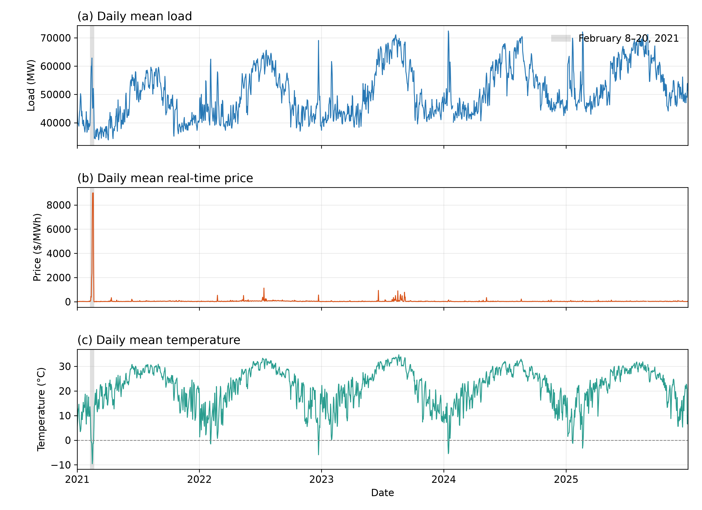

# How does weather affect Texas electricity demand and prices?

### 1. Introduction (3/4)

Electricity systems must meet changing demand while maintaining reliable supply. In Texas, understanding the relationship between weather, electricity demand, and wholesale prices is important for supply planning and managing exposure to high prices. A key question is whether hot and cold weather are associated with similar changes in demand and prices.

This study examines that question using hourly Electric Reliability Council of Texas (ERCOT) electricity and Texas weather data from 2021–2025. We estimate separate regressions for electricity load and real-time prices, comparing their sensitivity to heat and cold while controlling for weather and time patterns.

The results show that load is more sensitive to heat than to cold, while prices are strongly associated with both. However, the cold-weather price estimate falls substantially when the February 2021 winter storm period is excluded. The findings inform discussions of supply planning, price risk management, and the potential value of battery storage.

### 2. Background and Literature Review (3/4)

ERCOT operates a wholesale electricity market covering most of Texas. ERCOT’s scarcity-pricing mechanisms can raise real-time electricity prices when operating reserves are low, reflecting the increased risk of insufficient supply (ERCOT, 2025). Understanding how weather relates to electricity demand and prices is therefore relevant to supply planning and price risk management.

Shaffer et al. (2022) studied approximately 20 years of hourly data across ERCOT’s eight weather zones and found that electricity demand had become more sensitive to cold temperatures. Their use of hourly data and time fixed effects informs this study’s approach. Building on this, we use separate cooling and heating degree-hour variables instead of temperature-bin indicators and examine both system-wide load and real-time prices over 2021–2025.

Winter Storm Uri highlighted the vulnerability of electricity supply to extreme cold. The joint FERC–NERC–Regional Entity report (2021) documented widespread generation failures and recommended stronger winter preparation and better coordination between natural gas and electricity systems. Its February 8–20 event window provides the basis for this study’s storm-exclusion robustness check.

Storage is also relevant to hourly price differences. The U.S. Energy Information Administration (2025) reports that half of ERCOT’s battery capacity at the end of 2024 was primarily used for price arbitrage—charging at lower prices and selling at higher prices. This provides context for discussing storage in relation to the evening price pattern found in this study.

### 3. Theoretical Framework (1/2)

Weather can affect electricity demand through cooling and heating needs. Hot weather increases the need for air conditioning, while cold weather increases electricity use where heating relies on electricity. Demand may therefore be higher at both high and low temperatures than under mild conditions. This motivates using separate cooling degree-hour (CDD) and heating degree-hour (HDD) variables. The responses to heat and cold may differ because cooling and heating systems use different technologies and energy sources.

Electricity prices are determined by both supply and demand. Higher demand may raise prices, particularly when additional electricity supply is limited. Weather can also affect supply directly, including wind and solar generation and the availability of other generation facilities. The relationship between weather and electricity prices may therefore reflect changes on both sides of the market.

Based on these mechanisms, we estimate separate regressions of electricity load and prices on weather conditions. The CDD and HDD coefficients allow us to compare their associations with hot and cold weather. These regressions estimate how electricity demand and prices are associated with weather. However, they do not establish that higher demand causes higher prices or show how much of the weather-related price change comes from demand rather than supply.

### 4. Data and Methodology (3/4)

**Data.** We use hourly data from January 1, 2021 to December 31, 2025 (43,824 hours). Electricity demand is ERCOT system-wide hourly load (MW). Prices are ERCOT real-time settlement point prices at the ERCOT Hub Average (HB_HUBAVG), the simple average of the North, South, Houston, and West hub prices, reported in $/MWh at 15-minute intervals; we aggregate them to hourly values by taking the arithmetic mean of the four intervals within each hour.

Weather data come from the National Oceanic and Atmospheric Administration’s National Centers for Environmental Information (NOAA NCEI) hourly airport observations of temperature (°C), relative humidity (%), and wind speed (m/s) at four major Texas cities: Dallas–Fort Worth, Houston, San Antonio, and Austin. We aggregate them into a statewide measure using population weights of 0.3891, 0.3621, 0.1296, and 0.1192, respectively, based on the 2021–2025 average metropolitan-area population (U.S. Census Bureau, via Federal Reserve Economic Data (FRED)). We match weather observations to ERCOT hours using UTC timestamps, so that daylight saving transitions create neither gaps nor duplicates.

We exclude 395 hours (0.9%) with missing weather data at any of the four airports, which we do not impute, and three hours with physically impossible relative humidity values (outside 0–100%). The load regression therefore uses 43,426 hourly observations. Because the logarithm is undefined for non-positive values, the price regression additionally excludes 920 hours (2.1%) with zero or negative prices, leaving 42,506 observations; its estimates therefore describe hours with positive prices. Table 1 reports summary statistics for these samples.

**Table 1. Summary statistics, hourly observations, 2021–2025**

| Variable                      | Mean   | Median | Std    | Min    | Max     | N      |
| ----------------------------- | ------ | ------ | ------ | ------ | ------- | ------ |
| Load (MW)                     | 50,563 | 48,076 | 11,120 | 27,800 | 85,464  | 43,426 |
| Price, all hours ($/MWh)      | 63.9   | 24.8   | 451.2  | -34.8  | 9,024.1 | 43,426 |
| Price, positive hours ($/MWh) | 65.4   | 25.1   | 456.0  | 0.0025 | 9,024.1 | 42,506 |
| Temperature (°C)             | 21.16  | 22.51  | 8.78   | -13.78 | 41.46   | 43,426 |
| CDD (degree-hours)            | 5.51   | 4.51   | 5.50   | 0.00   | 23.46   | 43,426 |
| HDD (degree-hours)            | 2.35   | 0.00   | 4.57   | 0.00   | 31.78   | 43,426 |
| Relative humidity (%)         | 65.74  | 68.03  | 18.24  | 9.85   | 100.00  | 43,426 |
| Wind speed (m/s)              | 3.96   | 3.74   | 1.90   | 0.00   | 13.11   | 43,426 |

*Notes:* The sample is the load regression sample (N = 43,426 hourly observations). The second price row is the sample for the price regression (hours with positive prices). Weather variables are population-weighted averages of four airport stations. CDD and HDD are degree-hours relative to 18°C. Sources: ERCOT, NOAA, U.S. Census Bureau (via FRED).

**Empirical strategy.** Heating and cooling degree variables are defined relative to a base temperature of 18°C, close to the 65°F (≈18.3°C) base used in NOAA’s degree-day products (NOAA NCEI), LCDv2 documentation), and within the range where load is lowest in our data (Figure 1):

```math
\text{CDD}_t = \max{(T_t-18, 0)}, \text{HDD}_t = \max{(18-T_t, 0)}.
```

Because the data are hourly, these are degree-hours rather than degree-days. We estimate

```math
\ln(\text{Y}_t) = \beta_0 + \beta_1 \text{CDD}_t + \beta_2 \text{HDD}_t + \beta_3 \text{Humidity}_t + \beta_4 \text{Wind speed}_t + \text{Hour/Month/Year FE} + \varepsilon_t
```

where t indexes hours, Y_t is either ERCOT load or the real-time price, and Hour/Month/Year FE denote sets of dummy variables for the hour of day, the month of the year, and the year. Hour and month effects absorb intraday and seasonal patterns, and year effects absorb trends in demand and market conditions over 2021–2025. Here “hour” is the ERCOT hour-ending clock hour, so hour 20 covers 19:00–20:00 and hour 0 covers 23:00–24:00 of the previous day; month and year refer to the start of the hour. Standard errors are heteroskedasticity- and autocorrelation-consistent (HAC) with 24 lags. The CDD and HDD coefficients, multiplied by 100, approximate the percentage change in Y associated with one additional degree-hour, holding the other included variables fixed. We test whether β₁ = β₂ to compare sensitivity to heat and cold.

### 5. Results and Analysis (1 1/4)


**Figure 1.** Average ERCOT load (a) and median real-time price (b) by hourly temperature, 2021–2025. Temperatures are rounded to the nearest °C. Bins with fewer than 50 observations (below −4°C or above 39°C, 202 observations in total) are not shown. The dashed line marks the 18°C base temperature. Prices are hourly averages at the HB_HUBAVG hub-average settlement point. Sources: ERCOT, NOAA; authors’ calculations.

Figure 1 shows that both load and price are lowest at mild temperatures (about 14–19°C) and rise when the weather gets hotter or colder. The rise in load is bigger on the hot side. Load is about 81,000 MW at 39°C but only about 63,000 MW at −4°C, even though −4°C is slightly farther from the 18°C base (22°C versus 21°C). Prices also rise at both extremes, reaching about $97/MWh at 39°C and $79/MWh at −4°C, and the gap between hot and cold is smaller than for load. The hottest and coldest bins have few observations (94 at 39°C and 82 at −4°C), so we read them with caution. These patterns motivate using separate heating and cooling terms in the regressions below.

Because real-time prices are highly right-skewed (Table 1: standard deviation of $451/MWh versus a mean of $64/MWh, about seven times larger), the figures show medians rather than means.


**Figure 2.** Average ERCOT load (a) and median real-time price (b) by degree-hours above (CDD, hot weather) or below (HDD, cold weather) the 18°C base temperature. Degree-hours are rounded to the nearest integer, so bin k corresponds to a temperature of 18+k°C (CDD) or 18−k°C (HDD), as in Figure 1. Hours with fewer than 0.5 degree-hours and bins with fewer than 50 observations are not shown. Sources: ERCOT, NOAA; authors’ calculations.

Figure 2 plots the same variables against degree-hours above (hot) or below (cold) the 18°C base. At the same number of degree-hours, load is higher on the hot side. For example, at 15 degree-hours, average load is about 69,500 MW for CDD but about 51,900 MW for HDD, and the gap widens as degree-hours increase. Median prices are similar at low degree-hours (about $26 and $25 at 10 degree-hours) but diverge at higher levels, with about $38 for CDD and $29 for HDD at 15 degree-hours. The highest bins contain relatively few observations, so we do not rely on them (94 observations for CDD at 21 and 82 for HDD at 22).

**Table 2. Weather and ERCOT load and prices**

| Dependent variable | CDD       | HDD       | Humidity  | Wind speed  | CDD − HDD | N      | R²   |
| ------------------ | --------- | --------- | --------- | ----------- | ---------- | ------ | ----- |
| ln(Load)           | 0.0281*** | 0.0188*** | 0.0008*** | 0.0059***   | 0.0093***  | 43,426 | 0.922 |
|                    | (0.0003)  | (0.0005)  | (0.0001)  | (0.0005)    | (0.0006)   |        |       |
| ln(Price)          | 0.0771*** | 0.0809*** | 0.0080*** | −0.0633*** | −0.0038   | 42,506 | 0.341 |
|                    | (0.0038)  | (0.0089)  | (0.0009)  | (0.0066)    | (0.0088)   |        |       |

*Notes:* HAC standard errors (24 lags) in parentheses. *** p < 0.001. All regressions include hour, month, and year fixed effects. The price regression excludes 920 hours (2.1%) with non-positive prices. CDD and HDD are degree-hours relative to 18°C.

Table 2 reports the regression results. Both CDD and HDD are positively and significantly associated with load. Holding hour, month, year, humidity, and wind speed fixed, one additional degree-hour of cooling is associated with about 2.8% higher load, compared with about 1.9% for heating, and the difference is statistically significant (p < 0.001). Demand is therefore more sensitive to heat than to cold. Year effects rise steadily, with 2025 load about 23% above 2021 after controlling for weather. Table 3 converts these coefficients into implied load changes at illustrative temperatures.

Prices respond more strongly to weather than load does: one additional degree-hour of either cooling or heating is associated with about 8% higher prices in the full sample. The CDD and HDD coefficients are statistically indistinguishable (p = 0.67), so we do not conclude that prices respond more to heat than to cold. This comparison is sensitive to Winter Storm Uri. Excluding February 8–20, 2021 (301 hours, 0.7% of the price sample) lowers the HDD coefficient from 0.0809 to 0.0543, and heat then has a clearly larger effect on prices than cold (p < 0.001). The load results barely change (Appendix Table A1). Prices also follow a strong daily pattern: the 7–8 pm hour is about 100% more expensive than the 11 pm–midnight hour.

**Table 3. Implied Change in ERCOT Load Relative to an 18°C Hour**

| Scenario                 | Calculation            | Implied load increase |
| ------------------------ | ---------------------- | --------------------- |
| 28°C (10°C above base) | exp(10 × 0.0281) − 1 | ≈ 32%                |
| 33°C (15°C above base) | exp(15 × 0.0281) − 1 | ≈ 52%                |
| 8°C (10°C below base)  | exp(10 × 0.0188) − 1 | ≈ 21%                |

Note: Computed as exp(β × degree-hours) − 1 from Table 2, assuming that log load is linear in degree-hours.

### 6. Policy, Technical Implications and Discussion (1/2)

The findings suggest several implications for electricity supply planning and price risk management in ERCOT.

First, load rises more with heat than with cold (about 2.8% versus 1.9% per degree-hour), and 2025 load is about 23% above 2021 after controlling for weather and other included factors. Planning for sufficient electricity supply should therefore account for both weather conditions and demand growth.

Second, prices are more sensitive to temperature than load, and median prices at the temperature extremes are four to five times their minimum (Figure 1). Sudden price spikes can greatly increase costs for electricity retailers and large consumers that pay real-time prices. These businesses may reduce their exposure by locking in prices in advance or reducing electricity use during high-price hours.

Third, after controlling for weather and other included factors, prices in the 7–8 pm hour are about twice those in the 11 pm–midnight hour. This price difference suggests a potential role for battery energy storage systems (BESS), which charge during lower-price hours and discharge during higher-price hours. This strategy is already used in ERCOT: at the end of 2024, half of its 8.1 GW of battery capacity was primarily used for price arbitrage (U.S. Energy Information Administration, 2025). However, whether storage is economically worthwhile depends on the price difference, energy losses, and equipment costs. The evening price pattern therefore motivates further evaluation of storage.

Finally, winter planning should consider rare but severe storms. Excluding the February 2021 storm window (0.7% of the price sample) lowers the HDD coefficient by about one-third. Although this analysis does not identify the causes of the storm-related price increases, the result suggests that typical winter conditions alone provide an incomplete basis for assessing winter market risk. Preparing generation facilities and fuel supplies for severe cold may help address this risk.

### 7. Conclusion (1/3)

This study examines the relationship between weather, electricity demand, and real-time prices in ERCOT using hourly data from 2021–2025. Load is more sensitive to heat than to cold, while prices respond strongly to both. However, the estimated cold-weather price response falls substantially when the February 2021 winter storm period is excluded. Together with the highly skewed price distribution, this result highlights the importance of extreme events when assessing electricity price risk. These findings suggest a role for adequate reserves, demand response, and grid resilience in managing weather-related market stress.

Several limitations should be acknowledged. The linear CDD/HDD specification does not capture whether temperature effects accelerate at more extreme temperatures. The load and price regressions separately estimate how each variable is associated with weather. They do not show that higher electricity demand causes higher prices. Since the analysis does not include electricity supply variables, it cannot tell whether price changes come from changes in demand or supply. There is also a geographic mismatch: prices reflect a four-hub average that includes West Texas, whereas the weather index covers four major metropolitan areas and excludes that region. Finally, taking logarithms excludes zero and negative prices, potentially creating sample selection concerns and limiting the price results to positive-price hours.

Future research could include weather data from more parts of Texas and data on electricity generation, and use methods that allow for zero and negative prices. Comparing ERCOT with electricity markets in other U.S. states or other countries could help explain how market rules, energy sources, and weather conditions affect the results.

### 8. References 

Electric Reliability Council of Texas. (2025, October).  *ERCOT energy-only wholesale market* . [https://www.ercot.com/files/docs/2025/10/16/ERCOT-Grid-Insights-Energy-Only-Wholesale-Market.pdf](https://www.ercot.com/files/docs/2025/10/16/ERCOT-Grid-Insights-Energy-Only-Wholesale-Market.pdf)

Federal Energy Regulatory Commission, North American Electric Reliability Corporation, & Regional Entities. (2021, November).  *The February 2021 cold weather outages in Texas and the South Central United States* . [https://www.ferc.gov/media/february-2021-cold-weather-outages-texas-and-south-central-united-states-ferc-nerc-and](https://www.ferc.gov/media/february-2021-cold-weather-outages-texas-and-south-central-united-states-ferc-nerc-and)

Kantor, D., Casey, N. W., Menne, M. J., & Buddenberg, A. (2023). *Local climatological data (LCD), version 2* [Data set]. NOAA National Centers for Environmental Information

Shaffer, B., Quintero, D., & Rhodes, J. (2022). Changing sensitivity to cold weather in Texas power demand.  *iScience, 25* (4), 104173. [https://doi.org/10.1016/j.isci.2022.104173](https://doi.org/10.1016/j.isci.2022.104173)

U.S. Energy Information Administration. (2025, September 22).  *Utility-scale batteries are more commonly used for price arbitrage* . [https://www.eia.gov/todayinenergy/detail.php?id=66164](https://www.eia.gov/todayinenergy/detail.php?id=66164)

**Data sources**

| Resource                                              | Source                                                                                                       | Dataset or identifier                                                                                                                                                                                                                 |
| ----------------------------------------------------- | ------------------------------------------------------------------------------------------------------------ | ------------------------------------------------------------------------------------------------------------------------------------------------------------------------------------------------------------------------------------- |
| Hourly electricity load                               | Electric Reliability Council of Texas (ERCOT)                                                                | [Hourly Load Data Archives](https://www.ercot.com/gridinfo/load/load_hist), 2021–2025                                                                                                                                                 |
| Real-time electricity prices                          | ERCOT                                                                                                        | [Historical RTM Load Zone and Hub Prices](https://www.ercot.com/mp/data-products/data-product-details?id=NP6-785-ER); RTMLZHBSPP_2021–2025, HB_HUBAVG                                                                                 |
| Hourly temperature, relative humidity, and wind speed | National Oceanic and Atmospheric Administration (NOAA) National Centers for Environmental Information (NCEI) | [Local Climatological Data, Version 2](https://www.ncei.noaa.gov/products/land-based-station/local-climatological-data), 2021-2025. Airport codes: AUS, DFW, IAH, SAT.                                                               |
| Annual metropolitan population                        | U.S. Census Bureau, via Federal Reserve Economic Data (FRED)                                                | [DFWPOP](https://fred.stlouisfed.org/series/DFWPOP), [HTNPOP](https://fred.stlouisfed.org/series/HTNPOP), [SATPOP](https://fred.stlouisfed.org/series/SATPOP), [AUSPOP](https://fred.stlouisfed.org/series/AUSPOP), 2021-2025 (annual) |

*Note:* Weather station identifiers are AUS: USW00013904; DFW: USW00003927; IAH: USW00012960; and SAT: USW00012921.

**Data and code availability**

All data used in the analysis (electric load, electricity price, weather, and population) and all original code used in the analysis have been deposited at [http://github.com/nks1216/energy/](http://github.com/nks1216/energy/).

### 9. Appendix

**Figure A1. Daily mean load, price, temparature**



Figure A1. Daily mean ERCOT load (a), real-time hub-average price (b), and population-weighted temperature (c), 2021–2025. Daily means use available hourly observations after excluding missing regression variables and relative humidity values outside 0–100%. Zero and negative prices are included, and no temperature bins are excluded. Shading marks February 8–20, 2021. Sources: ERCOT, NOAA NCEI; authors’ calculations.


**Figure A2. Daily series with storm-period prices excluded**


Figure A2. Daily series from Figure A1 with February 8–20, 2021 excluded from the price panel only. The excluded prices are shown as a gap, and the price axis is rescaled to show variation outside this period. Load and temperature are unchanged. Sources: ERCOT, NOAA NCEI; authors’ calculations.

**Table A1: Full regression results for log electricity load**

```text
                            OLS Regression Results                          
==============================================================================
Dep. Variable:               log_load   R-squared:                       0.922
Model:                            OLS   Adj. R-squared:                  0.922
Method:                 Least Squares   F-statistic:                     2854.
Date:                Mon, 09 Nov 2026   Prob (F-statistic):               0.00
Time:                        21:25:41   Log-Likelihood:                 61288.
No. Observations:               43426   AIC:                        -1.225e+05
Df Residuals:                   43383   BIC:                        -1.221e+05
Df Model:                          42                                       
Covariance Type:                  HAC                                       
==========================================================================================
                             coef    std err          z      P>|z|      [0.025      0.975]
------------------------------------------------------------------------------------------
Intercept                 10.3840      0.009   1196.527      0.000      10.367      10.401
C(hour)[T.1]              -0.0451      0.001    -75.491      0.000      -0.046      -0.044
C(hour)[T.2]              -0.0779      0.001    -93.844      0.000      -0.080      -0.076
C(hour)[T.3]              -0.1001      0.001    -95.825      0.000      -0.102      -0.098
C(hour)[T.4]              -0.1109      0.001    -89.391      0.000      -0.113      -0.108
C(hour)[T.5]              -0.1060      0.001    -74.765      0.000      -0.109      -0.103
C(hour)[T.6]              -0.0788      0.002    -48.038      0.000      -0.082      -0.076
C(hour)[T.7]              -0.0374      0.002    -18.482      0.000      -0.041      -0.033
C(hour)[T.8]              -0.0204      0.002     -8.823      0.000      -0.025      -0.016
C(hour)[T.9]              -0.0019      0.002     -0.791      0.429      -0.007       0.003
C(hour)[T.10]              0.0174      0.003      6.948      0.000       0.013       0.022
C(hour)[T.11]              0.0317      0.003     12.499      0.000       0.027       0.037
C(hour)[T.12]              0.0417      0.003     16.610      0.000       0.037       0.047
C(hour)[T.13]              0.0489      0.003     19.518      0.000       0.044       0.054
C(hour)[T.14]              0.0570      0.003     22.521      0.000       0.052       0.062
C(hour)[T.15]              0.0628      0.003     24.580      0.000       0.058       0.068
C(hour)[T.16]              0.0706      0.003     27.839      0.000       0.066       0.076
C(hour)[T.17]              0.0827      0.002     33.839      0.000       0.078       0.088
C(hour)[T.18]              0.0974      0.002     43.141      0.000       0.093       0.102
C(hour)[T.19]              0.1102      0.002     53.779      0.000       0.106       0.114
C(hour)[T.20]              0.1138      0.002     67.407      0.000       0.111       0.117
C(hour)[T.21]              0.1100      0.001     83.796      0.000       0.107       0.113
C(hour)[T.22]              0.0908      0.001     94.950      0.000       0.089       0.093
C(hour)[T.23]              0.0496      0.001     80.925      0.000       0.048       0.051
C(month)[T.2]             -0.0176      0.007     -2.578      0.010      -0.031      -0.004
C(month)[T.3]             -0.0454      0.006     -7.996      0.000      -0.056      -0.034
C(month)[T.4]             -0.0240      0.006     -3.772      0.000      -0.036      -0.012
C(month)[T.5]              0.0320      0.007      4.853      0.000       0.019       0.045
C(month)[T.6]              0.0835      0.007     11.796      0.000       0.070       0.097
C(month)[T.7]              0.0883      0.008     11.570      0.000       0.073       0.103
C(month)[T.8]              0.1118      0.007     15.180      0.000       0.097       0.126
C(month)[T.9]              0.0846      0.007     12.087      0.000       0.071       0.098
C(month)[T.10]             0.0356      0.007      4.897      0.000       0.021       0.050
C(month)[T.11]            -0.0018      0.006     -0.325      0.745      -0.013       0.009
C(month)[T.12]             0.0192      0.005      3.810      0.000       0.009       0.029
C(year)[T.2022]            0.0607      0.003     18.626      0.000       0.054       0.067
C(year)[T.2023]            0.1014      0.003     32.399      0.000       0.095       0.108
C(year)[T.2024]            0.1452      0.003     47.182      0.000       0.139       0.151
C(year)[T.2025]            0.2043      0.003     66.063      0.000       0.198       0.210
CDD                        0.0281      0.000     91.374      0.000       0.028       0.029
HDD                        0.0188      0.001     35.321      0.000       0.018       0.020
HourlyRelativeHumidity     0.0008   6.91e-05     11.499      0.000       0.001       0.001
HourlyWindSpeed            0.0059      0.001     11.094      0.000       0.005       0.007
==============================================================================
Omnibus:                      954.137   Durbin-Watson:                   0.135
Prob(Omnibus):                  0.000   Jarque-Bera (JB):             1416.968
Skew:                          -0.241   Prob(JB):                    2.04e-308
Kurtosis:                       3.742   Cond. No.                     1.71e+03
==============================================================================

Notes:
[1] Standard Errors are heteroscedasticity and autocorrelation robust (HAC) using 24 lags and without small sample correction
[2] The condition number is large, 1.71e+03. This might indicate that there are
strong multicollinearity or other numerical problems.
```

**Table A2: Test of equal cooling and heating coefficients for log electricity load**

```
                             Test for Constraints                           
==============================================================================
                 coef    std err          z      P>|z|      [0.025      0.975]
------------------------------------------------------------------------------
c0             0.0093      0.001     15.093      0.000       0.008       0.011
==============================================================================
```

**Note:* The null hypothesis is $H_0: \beta_{\mathrm{CDD}} - \beta_{\mathrm{HDD}} = 0$.

**Table A3: Full regression results for log electricity price**

```
                            OLS Regression Results                          
==============================================================================
Dep. Variable:              log_price   R-squared:                       0.341
Model:                            OLS   Adj. R-squared:                  0.341
Method:                 Least Squares   F-statistic:                     97.44
Date:                Mon, 09 Nov 2026   Prob (F-statistic):               0.00
Time:                        21:26:23   Log-Likelihood:                -47598.
No. Observations:               42506   AIC:                         9.528e+04
Df Residuals:                   42463   BIC:                         9.565e+04
Df Model:                          42                                       
Covariance Type:                  HAC                                       
==========================================================================================
                             coef    std err          z      P>|z|      [0.025      0.975]
------------------------------------------------------------------------------------------
Intercept                  2.0977      0.122     17.193      0.000       1.859       2.337
C(hour)[T.1]              -0.0753      0.012     -6.537      0.000      -0.098      -0.053
C(hour)[T.2]              -0.1701      0.014    -12.346      0.000      -0.197      -0.143
C(hour)[T.3]              -0.2527      0.017    -15.186      0.000      -0.285      -0.220
C(hour)[T.4]              -0.2533      0.018    -14.250      0.000      -0.288      -0.218
C(hour)[T.5]              -0.2238      0.019    -11.835      0.000      -0.261      -0.187
C(hour)[T.6]              -0.1030      0.019     -5.386      0.000      -0.140      -0.066
C(hour)[T.7]               0.0714      0.021      3.369      0.001       0.030       0.113
C(hour)[T.8]               0.0638      0.020      3.257      0.001       0.025       0.102
C(hour)[T.9]              -0.0892      0.018     -4.875      0.000      -0.125      -0.053
C(hour)[T.10]             -0.1457      0.022     -6.617      0.000      -0.189      -0.103
C(hour)[T.11]             -0.1058      0.025     -4.302      0.000      -0.154      -0.058
C(hour)[T.12]             -0.0598      0.028     -2.143      0.032      -0.114      -0.005
C(hour)[T.13]              0.0010      0.032      0.032      0.975      -0.061       0.063
C(hour)[T.14]              0.0584      0.033      1.755      0.079      -0.007       0.124
C(hour)[T.15]              0.0931      0.034      2.711      0.007       0.026       0.160
C(hour)[T.16]              0.1589      0.033      4.782      0.000       0.094       0.224
C(hour)[T.17]              0.2902      0.033      8.707      0.000       0.225       0.356
C(hour)[T.18]              0.4750      0.030     15.858      0.000       0.416       0.534
C(hour)[T.19]              0.5922      0.025     23.391      0.000       0.543       0.642
C(hour)[T.20]              0.6932      0.022     31.074      0.000       0.649       0.737
C(hour)[T.21]              0.5848      0.018     31.917      0.000       0.549       0.621
C(hour)[T.22]              0.3266      0.013     25.511      0.000       0.302       0.352
C(hour)[T.23]              0.1577      0.010     15.230      0.000       0.137       0.178
C(month)[T.2]              0.1310      0.106      1.235      0.217      -0.077       0.339
C(month)[T.3]              0.2228      0.073      3.061      0.002       0.080       0.366
C(month)[T.4]              0.3278      0.079      4.171      0.000       0.174       0.482
C(month)[T.5]              0.3665      0.083      4.390      0.000       0.203       0.530
C(month)[T.6]              0.1896      0.086      2.204      0.028       0.021       0.358
C(month)[T.7]              0.1917      0.087      2.192      0.028       0.020       0.363
C(month)[T.8]              0.3680      0.090      4.086      0.000       0.192       0.545
C(month)[T.9]              0.3887      0.088      4.415      0.000       0.216       0.561
C(month)[T.10]             0.5141      0.083      6.191      0.000       0.351       0.677
C(month)[T.11]             0.4379      0.066      6.683      0.000       0.309       0.566
C(month)[T.12]             0.2499      0.059      4.219      0.000       0.134       0.366
C(year)[T.2022]            0.3594      0.045      7.948      0.000       0.271       0.448
C(year)[T.2023]           -0.2406      0.040     -6.081      0.000      -0.318      -0.163
C(year)[T.2024]           -0.4579      0.042    -10.933      0.000      -0.540      -0.376
C(year)[T.2025]           -0.0978      0.040     -2.448      0.014      -0.176      -0.020
CDD                        0.0771      0.004     20.465      0.000       0.070       0.085
HDD                        0.0809      0.009      9.076      0.000       0.063       0.098
HourlyRelativeHumidity     0.0080      0.001      8.788      0.000       0.006       0.010
HourlyWindSpeed           -0.0633      0.007     -9.615      0.000      -0.076      -0.050
==============================================================================
Omnibus:                    11840.447   Durbin-Watson:                   0.436
Prob(Omnibus):                  0.000   Jarque-Bera (JB):           597566.806
Skew:                          -0.550   Prob(JB):                         0.00
Kurtosis:                      21.335   Cond. No.                     1.71e+03
==============================================================================

Notes:
[1] Standard Errors are heteroscedasticity and autocorrelation robust (HAC) using 24 lags and without small sample correction
[2] The condition number is large, 1.71e+03. This might indicate that there are
strong multicollinearity or other numerical problems.
```


**Table A4: Test of equal cooling and heating coefficients for log electricity price**

```
                             Test for Constraints                           
==============================================================================
                 coef    std err          z      P>|z|      [0.025      0.975]
------------------------------------------------------------------------------
c0            -0.0038      0.009     -0.430      0.667      -0.021       0.013
==============================================================================
```

**Note:* The null hypothesis is **$H_0: \beta_{\mathrm{CDD}} - \beta_{\mathrm{HDD}} = 0$.
**


**Table A5. Sensitivity to Winter Storm Uri (February 8–20, 2021)**

|            | Load, full | Load, excl. Uri | Price, full | Price, excl. Uri |
| ---------- | ---------- | --------------- | ----------- | ---------------- |
| CDD        | 0.0281***  | 0.0281***       | 0.0771***   | 0.0742***        |
|            | (0.0003)   | (0.0003)        | (0.0038)    | (0.0036)         |
| HDD        | 0.0188***  | 0.0189***       | 0.0809***   | 0.0543***        |
|            | (0.0005)   | (0.0005)        | (0.0089)    | (0.0036)         |
| CDD − HDD | 0.0093***  | 0.0092***       | −0.0038    | 0.0199***        |
|            | (0.0006)   | (0.0006)        | (0.0088)    | (0.0049)         |
| N          | 43,426     | 43,114          | 42,506      | 42,205           |
| R²        | 0.922      | 0.925           | 0.341       | 0.356            |

*Notes:* HAC standard errors (24 lags) in parentheses. *** p < 0.001. All regressions include hour, month, and year fixed effects and the same controls as Table 2. “Excl. Uri” drops February 8–20, 2021.

As a robustness check, the regression was re-estimated after excluding the Winter Storm Uri period (February 13-20, 2021). While the HDD coefficient increased modestly, the overall results remained largely unchanged. This suggests that the main findings are not driven by the extreme conditions associated with Winter Storm Uri.
