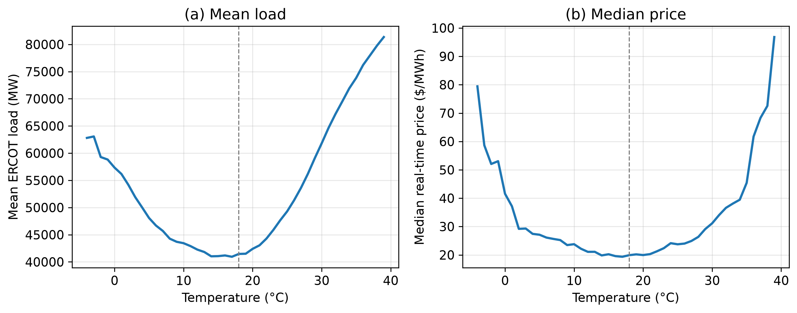
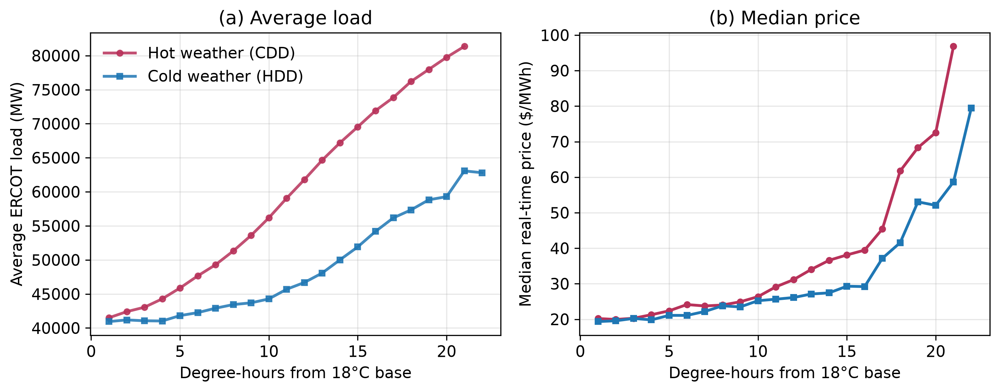
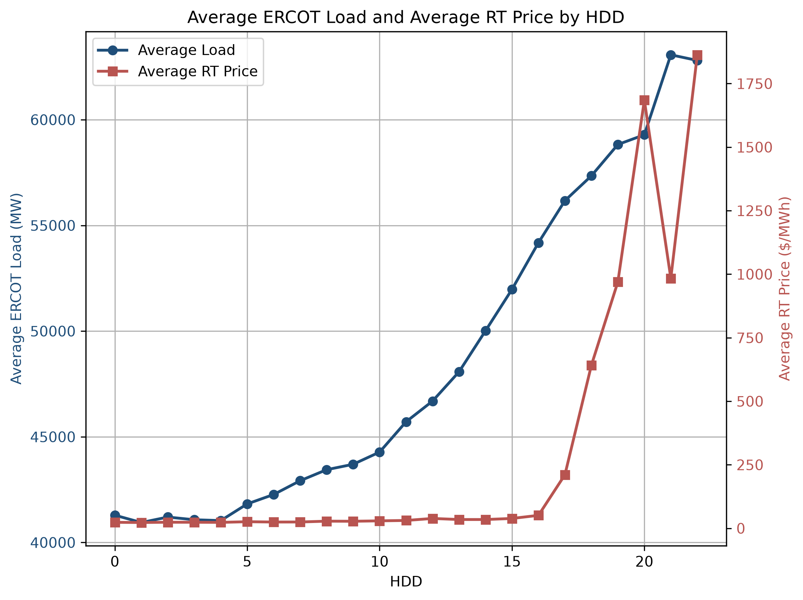

# How does weather affect Texas electricity demand and prices?

### 1. Introduction (3/4)

2021년~2025년

### 2. Background and Literature Review (3/4)

### 3. Theoretical Framework (1/2)

### 4. Data and Methodology (3/4)

**Data.** We use hourly data from January 1, 2021 to December 31, 2025. Electricity demand is ERCOT system-wide hourly load (MW). Prices are ERCOT real-time settlement point prices at the hub-average settlement point (HB_HUBAVG), reported in $/MWh at 15-minute intervals; we aggregate them to hourly values by taking the arithmetic mean of the four intervals within each hour.

Weather data come from NOAA hourly airport observations of temperature (°C), relative humidity (%), and wind speed (m/s) at four major Texas cities: Dallas–Fort Worth, Houston, San Antonio, and Austin. We aggregate them into a statewide measure using population weights of 0.3891, 0.3621, 0.1296, and 0.1192, respectively, based on the 2021–2025 average metropolitan-area population (U.S. Census Bureau, via FRED). We match weather observations to ERCOT hours using UTC timestamps, so that daylight saving transitions create neither gaps nor duplicates.

We exclude the final hour of the sample (hour ending 24:00 on December 31, 2025), 395 hours (0.9%) with missing weather data at any of the four airports, which we do not impute, and three hours with physically impossible relative humidity values (outside 0–100%). The load regression therefore uses 43,425 hourly observations. Because the logarithm is undefined for non-positive values, the price regression additionally excludes 924 hours (2.1%) with zero or negative prices, leaving 42,505 observations; its estimates therefore describe hours with positive prices. Table 1 reports summary statistics for these samples.

**Table 1. Summary statistics, hourly observations, 2021–2025**

| Variable                      | Mean   | Std    | Min    | Max     | N      |
| ----------------------------- | ------ | ------ | ------ | ------- | ------ |
| Load (MW)                     | 50,564 | 11,120 | 27,800 | 85,464  | 43,425 |
| Price, all hours ($/MWh)      | 63.9   | 451.2  | -34.8  | 9,024.1 | 43,425 |
| Price, positive hours ($/MWh) | 65.4   | 456.0  | 0.0025 | 9,024.1 | 42,505 |
| Temperature (°C)             | 21.16  | 8.78   | -13.78 | 41.46   | 43,425 |
| CDD (degree-hours)            | 5.51   | 5.50   | 0.00   | 23.46   | 43,425 |
| HDD (degree-hours)            | 2.35   | 4.57   | 0.00   | 31.78   | 43,425 |
| Relative humidity (%)         | 65.74  | 18.24  | 9.85   | 100.00  | 43,425 |
| Wind speed (m/s)              | 3.96   | 1.90   | 0.00   | 13.11   | 43,425 |

*Notes:* The sample is the load regression sample (N = 43,425 hours (observations)). The second price row is the sample for the price regression (hours with positive prices). Weather variables are population-weighted averages of four airport stations. CDD and HDD are degree-hours relative to 18°C. Sources: ERCOT, NOAA, U.S. Census Bureau (via FRED).

**Empirical strategy.** Heating and cooling degree variables are defined relative to a base temperature of 18°C, close to the 65°F (≈18.3°C) base used in NOAA’s degree-day products, and within the range where load is lowest in our data **(Figure 1)**:

CDD_t = max(T_t − 18, 0), HDD_t = max(18 − T_t, 0).

Because the data are hourly, these are degree-hours rather than degree-days. We estimate

ln(Y_t) = β₀ + β₁CDD_t + β₂HDD_t + β₃Humidity_t + β₄WindSpeed_t + α_h + γ_m + δ_y + ε_t,

where Y_t is either ERCOT load or the real-time price, and α_h, γ_m, and δ_y are hour-of-day, month-of-year, and year fixed effects. Hour and month effects absorb intraday and seasonal patterns, and year effects absorb trends in demand and market conditions over 2021–2025. Standard errors are heteroskedasticity- and autocorrelation-consistent (HAC) with 24 lags. Coefficients are interpreted approximately as the percentage change in Y associated with one additional degree-hour. We test whether β₁ = β₂ to compare sensitivity to heat and cold.

### 5. Results and Analysis (1 1/4)



**Figure 1.** Mean ERCOT load (a) and median real-time price (b) by hourly temperature, 2021–2025. Temperatures are rounded to the nearest °C. Bins with fewer than 50 observations (below −4°C or above 39°C, 202 observations in total) are not shown. The dashed line marks the 18°C base temperature. Prices are hourly averages at the HB_HUBAVG hub-average settlement point. Sources: ERCOT, NOAA; authors’ calculations.

Figure 1 shows that both load and price are lowest at mild temperatures (about 14–19°C) and rise when the weather gets hotter or colder. The rise in load is bigger on the hot side. Load is about 81,000 MW at 39°C but only about 63,000 MW at −4°C, even though −4°C is slightly farther from the 18°C base (22°C versus 21°C). Prices also rise at both extremes, reaching about $97/MWh at 39°C and $79/MWh at −4°C, and the gap between hot and cold is smaller than for load. The hottest and coldest bins have few observations (94 at 39°C and 82 at −4°C), so we read them with caution. These patterns motivate using separate heating and cooling terms in the regressions below.

Because real-time prices are highly right-skewed (Table 1: standard deviation of $451/MWh versus a mean of $64/MWh, about seven times larger), the figures show medians rather than means.



**Figure 2.** Average ERCOT load (a) and median real-time price (b) by degree-hours above (CDD, hot weather) or below (HDD, cold weather) the 18°C base temperature. Degree-hours are rounded to the nearest integer, so bin k corresponds to a temperature of 18+k°C (CDD) or 18−k°C (HDD), as in Figure 1. Hours with fewer than 0.5 degree-hours and bins with fewer than 50 observations are not shown. Sources: ERCOT, NOAA; authors’ calculations.

Figure 2 plots the same variables against degree-hours above (hot) or below (cold) the 18°C base. At the same number of degree-hours, load is higher on the hot side. For example, at 15 degree-hours, average load is about 69,500 MW for CDD but about 51,900 MW for HDD, and the gap widens as degree-hours increase. Median prices are similar at low degree-hours (about $26 and $25 at 10 degree-hours) but diverge at higher levels, with about $38 for CDD and $29 for HDD at 15 degree-hours. The highest bins contain relatively few observations, so we do not rely on them (94 observations for CDD at 21 and 82 for HDD at 22). The load pattern is consistent with the regression results below.


```math
\ln(\text{Load}_t) = \beta_0 + \beta_1 \text{CDD}_t + \beta_2 \text{HDD}_t + \beta_3 \text{Humidity}_t + \beta_4 \text{Wind Speed}_t + \text{Hour/Month/Year FE} + \varepsilon_t
```

**Table 2. Determinants of ERCOT Electricity Demand (Dependent variable: ln(Load))**

| Variable               | Coefficient | Std. Error | p-value |
| ---------------------- | ----------- | ---------- | ------- |
| CDD                    | 0.0281      | 0.0003     | <0.001  |
| HDD                    | 0.0188      | 0.0005     | <0.001  |
| Humidity               | 0.0008      | 0.00007    | <0.001  |
| Wind Speed             | 0.0059      | 0.0005     | <0.001  |
| Hour / Month / Year FE | Yes         |            |         |
| R²                    | 0.922       |            |         |
| N                      | 43,425      |            |         |
|                        |             |            |         |

Notes: HAC standard errors (24 lags) in parentheses. Sample: hourly observations, 2021–2025.

(표준오차 추가하기)

Table 2 reports the results. Both CDD and HDD have positive and statistically significant effects on electricity demand. Holding hour, month, and year fixed, a one-unit increase in CDD raises load by approximately 2.8%, compared with approximately 1.9% for HDD. The difference between the two coefficients is statistically significant (p < 0.001), suggesting that demand is more sensitive to hot weather than to cold weather. Year fixed effects rise monotonically, with 2025 load about 23% higher than 2021 after controlling for weather, consistent with structural demand growth.

Table 3. Implied Change in ERCOT Load Relative to an 18°C Hour

| Scenario                 | Calculation            | Implied load increase |
| ------------------------ | ---------------------- | --------------------- |
| 28°C (10°C above base) | exp(10 × 0.0281) − 1 | ≈ 32%                |
| 33°C (15°C above base) | exp(15 × 0.0281) − 1 | ≈ 52%                |
| 8°C (10°C below base)  | exp(10 × 0.0188) − 1 | ≈ 21%                |

```math
\ln(\text{Price}_t) = \beta_0 + \beta_1 \text{CDD}_t + \beta_2 \text{HDD}_t + \beta_3 \text{Humidity}_t + \beta_4 \text{Wind Speed}_t + \text{Hour/Month/Year FE} + \varepsilon_t
```

**Table 4. Determinants of ERCOT Real-Time Prices (Dependent variable: ln(price))**

| Variable               | Coefficient | Std. Error | p-value |
| ---------------------- | ----------- | ---------- | ------- |
| CDD                    | 0.0771      | 0.0038     | <0.001  |
| HDD                    | 0.0809      | 0.0089     | <0.001  |
| Humidity               | 0.0080      | 0.0009     | <0.001  |
| Wind Speed             | −0.0633    | 0.0066     | <0.001  |
| Hour / Month / Year FE | Yes         |            |         |
| R²                    | 0.341       |            |         |
| N                      | 42,505      |            |         |

Notes: HAC standard errors (24 lags); hours with non-positive prices (924, 2.1%) excluded

Table 4 shows that both CDD and HDD are positively and significantly associated with real-time prices: a one-unit increase in either is associated with roughly 8% higher prices. Unlike the load regression, the difference between the two coefficients is not statistically significant (p = 0.67), so we cannot conclude that prices respond more strongly to heat than to cold. Prices follow a pronounced intraday pattern, with hour 20 about 100% higher than hour 0.

### 6. Policy Implications or Discussion (1/2)

While median prices increase gradually with both CDD and HDD, average prices rise much more sharply during extreme weather conditions, indicating the presence of occasional but substantial price spikes. This finding highlights the importance of adequate reserve capacity, demand response programs, and grid resilience measures to mitigate the risk of extreme market outcomes

While this study focuses on ERCOT, future research could compare these relationships with electricity markets in other countries such as South Korea, where market design, fuel mix, and weather patterns differ substantially.

### 7. Conclusion (1/3)

### 8. References (Seperate)

> 같은 여름철에도 매우 더운 날은 비교적 덜 더운 날보다 전력수요가 10% 높았고, 도매가격은 MWh당 20달러 높았다.

**전력 사용량의 증가와 가격 부담의 증가를 함께 보여주므로 경제 분석이 분명해짐 / ** 다만 두 결과만으로 수요 증가가 가격 상승을 일으켰다고 확정하지는 않습니다.

정책 논의는 결과에 맞추어 연결

> 매우 더운 날에 수요와 가격이 모두 높게 나타난다면, 이러한 날에 전력 사용을 줄이도록 유도하는 정책을 검토할 근거가 된다. 다만 정책의 실제 효과와 비용은 별도 평가가 필요하다.

**< Raw Data >**

**1. Electricity demand: ERCOT**

Home > Grid Information > Load > Hourly Load Data Archives

[www.ercot.com/gridinfo/load/load_hist](https://www.ercot.com/gridinfo/load/load_hist)

[2021 ERCOT Hourly Load Data](https://www.ercot.com/files/docs/2021/11/12/Native_Load_2021.zip "2021 ERCOT Hourly Load Data") ~ [2025 ERCOT Hourly Load Data](https://www.ercot.com/files/docs/2025/02/11/Native_Load_2025.zip "2025 ERCOT Hourly Load Data")

**2. Electricity price: ERCOT**

Home > Market Participants > EMIL > Data Product Details

[www.ercot.com/mp/data-products/data-product-details?id=NP6-785-ER](https://www.ercot.com/mp/data-products/data-product-details?id=NP6-785-ER)

RTMLZHBSPP_2021 ~ RTMLZHBSPP_2025

**3. Temperature: NOAA**

Local Climatological Data V2

[www.ncei.noaa.gov](https://www.ncei.noaa.gov/)

| city                  | airport | station name                           | GHCN ID               |
| --------------------- | ------- | -------------------------------------- | --------------------- |
| **Austin**      | AUS     | AUSTIN BERGSTROM INTERNATIONAL AIRPORT | **USW00013904** |
| **Dallas**      | DFW     | DAL FTW WSCMO AIRPORT                  | **USW00003927** |
| **Houston**     | IAH     | HOUSTON INTERCONTINENTAL AIRPORT       | **USW00012960** |
| **San Antonio** | SAT     | SAN ANTONIO INTERNATIONAL AIRPORT      | **USW00012921** |

**4. Population: FRED**

FRED (Federal Reserve Economic Data)

[fred.stlouisfed.org/series/AUSPOP](https://fred.stlouisfed.org/series/AUSPOP)

[Home](https://fred.stlouisfed.org/)>[Categories](https://fred.stlouisfed.org/categories)>[U.S. Regional Data](https://fred.stlouisfed.org/categories/3008)>[States](https://fred.stlouisfed.org/categories/27281)>[Texas](https://fred.stlouisfed.org/categories/27326)>[MSAs](https://fred.stlouisfed.org/categories/30907)>[Austin-Round Rock-San Marcos, TX](https://fred.stlouisfed.org/categories/30910)

* **Dallas-Fort Worth MSA** :`DFWPOP`
* **Houston MSA** :`HTNPOP`
* **San Antonio MSA** :`SATPOP`
* **Austin MSA** :`AUSPOP`

To capture the weather-driven component of the system-wide load, we construct a population-weighted temperature index based on the four major metropolitan statistical areas (MSAs)—Dallas, Houston, San Antonio, and Austin—which account for the vast majority of Texas's population and aggregated electricity consumption.

Population weights are derived from the U.S. Census Bureau Annual Metropolitan Area Resident Population Estimates for Dallas-Fort Worth, Houston, San Antonio, and Austin MSAs, retrieved via FRED (Federal Reserve Economic Data). A fixed average share across the 2021–2025 sample period is applied to construct the population-weighted statewide weather indices.

ERCOT

DST 데이터가 있어서, 일단 DST 가 변하는 지점의 데이터 두 개 모두 살림

Price

The hourly real-time electricity price is calculated as the arithmetic average of four 15-minute settlement prices at the HB_HUBAVG settlement point.

한계점: 극단 기온에서 효과가 가속되는지는 CDD/HDD 선형 모델이 보여 주지 못함. 이 회귀는 기온과 부하·가격의 연관을 보여 주고, 풍력이나 태양광 같은 원인을 식별하지는 않음.

### 9. Appendix



Appendix Figures A1 and A2 show that mean prices increase substantially more than median prices at high HDD and CDD values, indicating the presence of extreme price spikes during severe weather events.

As a robustness check, the regression was re-estimated after excluding the Winter Storm Uri period (February 13-20, 2021). While the HDD coefficient increased modestly, the overall results remained largely unchanged. This suggests that the main findings are not driven by the extreme conditions associated with Winter Storm Uri.

OLS results

NOAA’s degree-day products (NOAA NCEI, LCDv2 documentation)


Figure 1 shows the relationship between temperature and ERCOT electricity demand. Electricity demand is lowest at approximately 15-18°C and increases as temperatures become either colder or hotter. This creates a clear U-shaped relationship between temperature and electricity demand.
