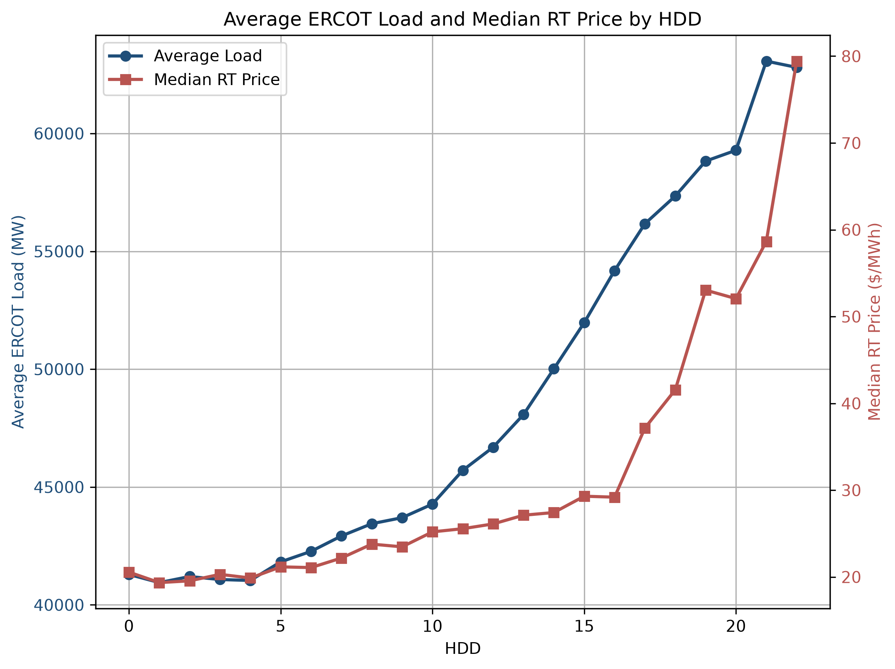

Heating and cooling degree variables are constructed using a base temperature of 18°C.

* CDD = Cooling Degree Days
* HDD = Heating Degree Days

Bins with fewer than 50 observations were excluded, and only observations with positive Heating Degree Days (HDD > 0) were retained. Since HDD values were rounded to the nearest integer for plotting, the HDD = 0 bin corresponds to observations with small positive HDD values rather than observations with zero heating demand.

Average ERCOT load increases monotonically with both cooling and heating degree days. However, the relationship is considerably steeper for CDD than for HDD, suggesting that electricity demand in Texas is more sensitive to cooling needs than to heating needs. The pattern is consistent with the state's heavy reliance on air conditioning during hot weather.

ERCOT Load and Electricity Prices by Cooling Degree Days (CDD)


Bins with fewer than 50 observations were excluded. CDD values were rounded to the nearest integer for visualization, and only observations with positive CDD values were retained. As a result of the rounding procedure, the bin labeled CDD = 0 represents observations with small but positive CDD values (i.e., 0<CDD<0.50), rather than observations with zero cooling degree days.

Figure 4 shows a strong positive relationship between cooling degree days (CDD), electricity demand, and real-time electricity prices. Average ERCOT load increases steadily with CDD, indicating higher electricity demand during hotter weather. Both average and median RT prices also rise with CDD. However, average RT prices increase much more sharply than median RT prices at high CDD levels, suggesting that extreme heat is associated with occasional scarcity-pricing events and price spikes in the ERCOT market.

ERCOT Load and Electricity Prices by Heating Degree Days (HDD)



HDD values were rounded to the nearest integer for visualization, and only observations with positive HDD values were retained. Consequently, the bin labeled HDD = 0 represents observations with small but positive HDD values (0<HDD<0.50) generated by the rounding procedure.

Figure 5 shows that both ERCOT electricity demand and median real-time prices increase with heating degree days (HDD). Average ERCOT load rises from approximately 41 GW at low HDD levels to more than 63 GW at high HDD levels, reflecting higher electricity demand during colder weather. Median RT prices also increase from about $20/MWh to nearly $80/MWh as HDD rises. These results suggest that cold-weather conditions place upward pressure on both electricity demand and wholesale electricity prices in ERCOT.

```math
\ln(\text{Load}_t) = \beta_0 + \beta_1 \text{CDD}_t + \beta_2 \text{HDD}_t + \beta_3 \text{Humidity}_t + \beta_4 \text{Wind Speed}_t + \text{Hour/Month/Year FE} + \varepsilon_t
```

**Table 2. Determinants of ERCOT Electricity Demand (Dependent variable: ln(Load))**

| Variable               | Coefficient | Std. Error | p-value |
| ---------------------- | ----------- | ---------- | ------- |
| CDD                    | 0.0281      | 0.0003     | <0.001  |
| HDD                    | 0.0188      | 0.0005     | <0.001  |
| Humidity               | 0.0008      | 0.00007    | <0.001  |
| Wind Speed             | 0.0059      | 0.0005     | <0.001  |
| Hour / Month / Year FE | Yes         |            |         |
| R²                    | 0.922       |            |         |
| N                      | 43,425      |            |         |
|                        |             |            |         |

Notes: HAC standard errors (24 lags) in parentheses. Sample: hourly observations, 2021–2025.


**Figure 1.** Average ERCOT load (a) and median real-time price (b) by hourly temperature, 2021–2025. Temperatures are rounded to the nearest °C. Bins with fewer than 50 observations (below −4°C or above 39°C, 202 observations in total) are not shown. The dashed line marks 18°C. Prices are hourly HB_HUBAVG averages. Sources: ERCOT, NOAA; authors’ calculations.

Figure 1 shows that both load and price are lowest at mild temperatures (about 14–19°C) and rise when the weather gets hotter or colder. The rise in load is bigger on the hot side. Load is about 81,000 MW at 39°C but only about 63,000 MW at −4°C, even though −4°C is slightly farther from the 18°C base (22°C versus 21°C). Prices also rise at both extremes, reaching about $97/MWh at 39°C and $79/MWh at −4°C, and the gap between hot and cold is smaller than for load. The hottest and coldest bins have few observations (94 at 39°C and 82 at −4°C), so we read them with caution. These patterns motivate using separate heating and cooling terms in the regressions below.

Because real-time prices are highly right-skewed (Table 1: standard deviation of $451/MWh versus a mean of $64/MWh, about seven times larger), the figures show medians rather than means.


**Figure 2.** Average ERCOT load (a) and median real-time price (b) by CDD and HDD relative to 18°C. Degree-hours are rounded to integers. Hours with fewer than 0.5 degree-hours and bins with fewer than 50 observations are omitted. Sources: ERCOT, NOAA; authors’ calculations.

Figure 2 plots the same variables against degree-hours above (hot) or below (cold) the 18°C base. At the same number of degree-hours, load is higher on the hot side. For example, at 15 degree-hours, average load is about 69,500 MW for CDD but about 51,900 MW for HDD, and the gap widens as degree-hours increase. Median prices are similar at low degree-hours (about $26 and $25 at 10 degree-hours) but diverge at higher levels, with about $38 for CDD and $29 for HDD at 15 degree-hours. The highest bins contain relatively few observations, so we do not rely on them (94 observations for CDD at 21 and 82 for HDD at 22).


Table 2 reports the results. Both CDD and HDD have positive and statistically significant effects on electricity demand. Holding hour, month, and year fixed, a one-unit increase in CDD raises load by approximately 2.8%, compared with approximately 1.9% for HDD. The difference between the two coefficients is statistically significant (p < 0.001), suggesting that demand is more sensitive to hot weather than to cold weather. Year fixed effects rise monotonically, with 2025 load about 23% higher than 2021 after controlling for weather, consistent with structural demand growth.

Table 3. Implied Change in ERCOT Load Relative to an 18°C Hour

| Scenario                 | Calculation            | Implied load increase |
| ------------------------ | ---------------------- | --------------------- |
| 28°C (10°C above base) | exp(10 × 0.0281) − 1 | ≈ 32%                |
| 33°C (15°C above base) | exp(15 × 0.0281) − 1 | ≈ 52%                |
| 8°C (10°C below base)  | exp(10 × 0.0188) − 1 | ≈ 21%                |

```math
\ln(\text{Price}_t) = \beta_0 + \beta_1 \text{CDD}_t + \beta_2 \text{HDD}_t + \beta_3 \text{Humidity}_t + \beta_4 \text{Wind Speed}_t + \text{Hour/Month/Year FE} + \varepsilon_t
```

**Table 4. Determinants of ERCOT Real-Time Prices (Dependent variable: ln(price))**

| Variable               | Coefficient | Std. Error | p-value |
| ---------------------- | ----------- | ---------- | ------- |
| CDD                    | 0.0771      | 0.0038     | <0.001  |
| HDD                    | 0.0809      | 0.0089     | <0.001  |
| Humidity               | 0.0080      | 0.0009     | <0.001  |
| Wind Speed             | −0.0633    | 0.0066     | <0.001  |
| Hour / Month / Year FE | Yes         |            |         |
| R²                    | 0.341       |            |         |
| N                      | 42,505      |            |         |

Notes: HAC standard errors (24 lags); hours with non-positive prices (924, 2.1%) excluded

Table 4 shows that both CDD and HDD are positively and significantly associated with real-time prices: a one-unit increase in either is associated with roughly 8% higher prices. Unlike the load regression, the difference between the two coefficients is not statistically significant (p = 0.67), so we cannot conclude that prices respond more strongly to heat than to cold. Prices follow a pronounced intraday pattern, with hour 20 about 100% higher than hour 0.

전력 수요: 텍사스 시간별 전력 수요(2021-01-01~2025-12-31, ERCOT)

전력 가격: 텍사스 15분 단위 허브평균 전력 real-time 도매가격(Settlement Point Name: HB_HUBAVG)을 시간 단위로 평균 (2021-01-01~2025-12-31, ERCOT)

(The hourly real-time electricity price is calculated as the arithmetic average of four 15-minute settlement prices at the HB_HUBAVG settlement point.)

기상 관측치: 오스틴, 달라스-포트워스, 샌안토니오, 휴스턴 4개 도시 각 공항의 시간별 기온(섭씨), 상대습도(%), 풍속(2021-01-01~2025-12-31, NOAA)에 대해 인구 가중 평균하여 텍사스 전체 기상 관측치를 만듦

인구 가중치: 최근 5개년 텍사스 4개 도시의 인구 수를 각각 평균한 후 가중치 구성(2021-01-01, 2022-01-01, 2023-01-01, 2024-01-01, 2025-01-01, the U.S. Census Bureau Annual Metropolitan Area Resident Population Estimates, via FRED / Dallas: 0.3891, Houston: 0.3621, Sanantonio: 0.1296, Austin: 0.1192)

ERCOT 수요, 가격 자료는 DST가 있는 자료 모두 포함, NOAA 데이터를 UTC로 변환한 후 ERCOT 데이터와 병합하였고, 시각화 및 회귀 분석은 실제 상황에 맞게 해석하고자 ERCOT 시간 기준(local time)을 사용

Limitation

While median prices increase gradually with both CDD and HDD, average prices rise much more sharply during extreme weather conditions, indicating the presence of occasional but substantial price spikes. This finding highlights the importance of adequate reserve capacity, demand response programs, and grid resilience measures to mitigate the risk of extreme market outcomes

While this study focuses on ERCOT, future research could compare these relationships with electricity markets in other countries such as South Korea, where market design, fuel mix, and weather patterns differ substantially.

The price is a statewide hub average that includes the West hub, whereas our weather index covers four large metropolitan areas and excludes West Texas, so the estimated temperature responses may understate sensitivity at the system level.

한계점: 극단 기온에서 효과가 가속되는지는 CDD/HDD 선형 모델이 보여 주지 못함. 이 회귀는 기온과 부하·가격의 연관을 보여 주고, 풍력이나 태양광 같은 원인을 식별하지는 않음.

**< Raw Data >**

**1. Electricity demand: ERCOT**

Home > Grid Information > Load > Hourly Load Data Archives

[www.ercot.com/gridinfo/load/load_hist](https://www.ercot.com/gridinfo/load/load_hist)

[2021 ERCOT Hourly Load Data](https://www.ercot.com/files/docs/2021/11/12/Native_Load_2021.zip "2021 ERCOT Hourly Load Data") ~ [2025 ERCOT Hourly Load Data](https://www.ercot.com/files/docs/2025/02/11/Native_Load_2025.zip "2025 ERCOT Hourly Load Data")

**2. Electricity price: ERCOT**

Home > Market Participants > EMIL > Data Product Details

[www.ercot.com/mp/data-products/data-product-details?id=NP6-785-ER](https://www.ercot.com/mp/data-products/data-product-details?id=NP6-785-ER)

RTMLZHBSPP_2021 ~ RTMLZHBSPP_2025

**3. Temperature: NOAA**

Local Climatological Data V2

[www.ncei.noaa.gov](https://www.ncei.noaa.gov/)

| city                  | airport | station name                           | GHCN ID               |
| --------------------- | ------- | -------------------------------------- | --------------------- |
| **Austin**      | AUS     | AUSTIN BERGSTROM INTERNATIONAL AIRPORT | **USW00013904** |
| **Dallas**      | DFW     | DAL FTW WSCMO AIRPORT                  | **USW00003927** |
| **Houston**     | IAH     | HOUSTON INTERCONTINENTAL AIRPORT       | **USW00012960** |
| **San Antonio** | SAT     | SAN ANTONIO INTERNATIONAL AIRPORT      | **USW00012921** |

**4. Population: FRED**

FRED (Federal Reserve Economic Data)

[fred.stlouisfed.org/series/AUSPOP](https://fred.stlouisfed.org/series/AUSPOP)

[Home](https://fred.stlouisfed.org/)>[Categories](https://fred.stlouisfed.org/categories)>[U.S. Regional Data](https://fred.stlouisfed.org/categories/3008)>[States](https://fred.stlouisfed.org/categories/27281)>[Texas](https://fred.stlouisfed.org/categories/27326)>[MSAs](https://fred.stlouisfed.org/categories/30907)>[Austin-Round Rock-San Marcos, TX](https://fred.stlouisfed.org/categories/30910)

* **Dallas-Fort Worth MSA** :`DFWPOP`
* **Houston MSA** :`HTNPOP`
* **San Antonio MSA** :`SATPOP`
* **Austin MSA** :`AUSPOP`

To capture the weather-driven component of the system-wide load, we construct a population-weighted temperature index based on the four major metropolitan statistical areas (MSAs)—Dallas, Houston, San Antonio, and Austin—which account for the vast majority of Texas's population and aggregated electricity consumption.

Population weights are derived from the U.S. Census Bureau Annual Metropolitan Area Resident Population Estimates for Dallas-Fort Worth, Houston, San Antonio, and Austin MSAs, retrieved via FRED (Federal Reserve Economic Data). A fixed average share across the 2021–2025 sample period is applied to construct the population-weighted statewide weather indices.
