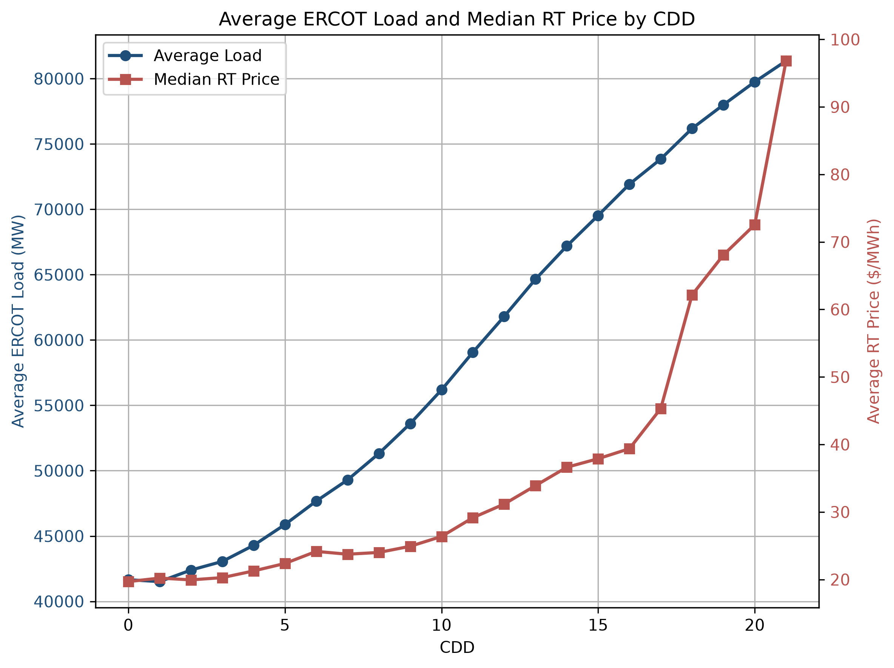

Heating and cooling degree variables are constructed using a base temperature of 18°C.

* CDD = Cooling Degree Days
* HDD = Heating Degree Days

Bins with fewer than 50 observations were excluded, and only observations with positive Heating Degree Days (HDD > 0) were retained. Since HDD values were rounded to the nearest integer for plotting, the HDD = 0 bin corresponds to observations with small positive HDD values rather than observations with zero heating demand.

Average ERCOT load increases monotonically with both cooling and heating degree days. However, the relationship is considerably steeper for CDD than for HDD, suggesting that electricity demand in Texas is more sensitive to cooling needs than to heating needs. The pattern is consistent with the state's heavy reliance on air conditioning during hot weather.

ERCOT Load and Electricity Prices by Cooling Degree Days (CDD)



Bins with fewer than 50 observations were excluded. CDD values were rounded to the nearest integer for visualization, and only observations with positive CDD values were retained. As a result of the rounding procedure, the bin labeled CDD = 0 represents observations with small but positive CDD values (i.e., 0<CDD<0.50), rather than observations with zero cooling degree days.

Figure 4 shows a strong positive relationship between cooling degree days (CDD), electricity demand, and real-time electricity prices. Average ERCOT load increases steadily with CDD, indicating higher electricity demand during hotter weather. Both average and median RT prices also rise with CDD. However, average RT prices increase much more sharply than median RT prices at high CDD levels, suggesting that extreme heat is associated with occasional scarcity-pricing events and price spikes in the ERCOT market.

ERCOT Load and Electricity Prices by Heating Degree Days (HDD)


HDD values were rounded to the nearest integer for visualization, and only observations with positive HDD values were retained. Consequently, the bin labeled HDD = 0 represents observations with small but positive HDD values (0<HDD<0.50) generated by the rounding procedure.

Figure 5 shows that both ERCOT electricity demand and median real-time prices increase with heating degree days (HDD). Average ERCOT load rises from approximately 41 GW at low HDD levels to more than 63 GW at high HDD levels, reflecting higher electricity demand during colder weather. Median RT prices also increase from about $20/MWh to nearly $80/MWh as HDD rises. These results suggest that cold-weather conditions place upward pressure on both electricity demand and wholesale electricity prices in ERCOT.


```math
\ln(\text{Load}_t) = \beta_0 + \beta_1 \text{CDD}_t + \beta_2 \text{HDD}_t + \beta_3 \text{Humidity}_t + \beta_4 \text{Wind Speed}_t + \text{Hour/Month/Year FE} + \varepsilon_t
```

**Table 2. Determinants of ERCOT Electricity Demand (Dependent variable: ln(Load))**

| Variable               | Coefficient | Std. Error | p-value |
| ---------------------- | ----------- | ---------- | ------- |
| CDD                    | 0.0281      | 0.0003     | <0.001  |
| HDD                    | 0.0188      | 0.0005     | <0.001  |
| Humidity               | 0.0008      | 0.00007    | <0.001  |
| Wind Speed             | 0.0059      | 0.0005     | <0.001  |
| Hour / Month / Year FE | Yes         |            |         |
| R²                    | 0.922       |            |         |
| N                      | 43,425      |            |         |
|                        |             |            |         |

Notes: HAC standard errors (24 lags) in parentheses. Sample: hourly observations, 2021–2025.

(표준오차 추가하기)

Table 2 reports the results. Both CDD and HDD have positive and statistically significant effects on electricity demand. Holding hour, month, and year fixed, a one-unit increase in CDD raises load by approximately 2.8%, compared with approximately 1.9% for HDD. The difference between the two coefficients is statistically significant (p < 0.001), suggesting that demand is more sensitive to hot weather than to cold weather. Year fixed effects rise monotonically, with 2025 load about 23% higher than 2021 after controlling for weather, consistent with structural demand growth.

Table 3. Implied Change in ERCOT Load Relative to an 18°C Hour

| Scenario                 | Calculation            | Implied load increase |
| ------------------------ | ---------------------- | --------------------- |
| 28°C (10°C above base) | exp(10 × 0.0281) − 1 | ≈ 32%                |
| 33°C (15°C above base) | exp(15 × 0.0281) − 1 | ≈ 52%                |
| 8°C (10°C below base)  | exp(10 × 0.0188) − 1 | ≈ 21%                |

```math
\ln(\text{Price}_t) = \beta_0 + \beta_1 \text{CDD}_t + \beta_2 \text{HDD}_t + \beta_3 \text{Humidity}_t + \beta_4 \text{Wind Speed}_t + \text{Hour/Month/Year FE} + \varepsilon_t
```

**Table 4. Determinants of ERCOT Real-Time Prices (Dependent variable: ln(price))**

| Variable               | Coefficient | Std. Error | p-value |
| ---------------------- | ----------- | ---------- | ------- |
| CDD                    | 0.0771      | 0.0038     | <0.001  |
| HDD                    | 0.0809      | 0.0089     | <0.001  |
| Humidity               | 0.0080      | 0.0009     | <0.001  |
| Wind Speed             | −0.0633    | 0.0066     | <0.001  |
| Hour / Month / Year FE | Yes         |            |         |
| R²                    | 0.341       |            |         |
| N                      | 42,505      |            |         |

Notes: HAC standard errors (24 lags); hours with non-positive prices (924, 2.1%) excluded

Table 4 shows that both CDD and HDD are positively and significantly associated with real-time prices: a one-unit increase in either is associated with roughly 8% higher prices. Unlike the load regression, the difference between the two coefficients is not statistically significant (p = 0.67), so we cannot conclude that prices respond more strongly to heat than to cold. Prices follow a pronounced intraday pattern, with hour 20 about 100% higher than hour 0.
